# 検知アルゴリズム レビュー（自動生成部分）

検知器: **baseline** = {'accel_peak_min': 25.0, 'gyro_peak_min': 4.0, 'gyro_window_before_s': 1.5, 'gyro_window_after_s': 0.5, 'min_interval_s': 8.0, 'smooth_s': 0.0, 'post_gyro_mean_max': 0.0, 'post_still_start_s': 0.5, 'post_still_end_s': 3.0}; **P1** = {'accel_peak_min': 25.0, 'gyro_peak_min': 4.0, 'gyro_window_before_s': 1.5, 'gyro_window_after_s': 0.5, 'min_interval_s': 8.0, 'smooth_s': 0.0, 'post_gyro_mean_max': 1.5, 'post_still_start_s': 0.5, 'post_still_end_s': 3.0}; **P2** = {'accel_peak_min': 20.0, 'gyro_peak_min': 4.0, 'gyro_window_before_s': 1.5, 'gyro_window_after_s': 0.5, 'min_interval_s': 8.0, 'smooth_s': 0.0, 'post_gyro_mean_max': 1.0, 'post_still_start_s': 0.5, 'post_still_end_s': 3.0}

## 1. CAST マーカーと検知時刻の時間差分布（照合窓 −2〜+12 秒の妥当性）

P1 検知器（静止フィルタあり）の検出を、広い窓（−10〜+30 秒、ただし次の CAST の 2 秒前まで）で 1 対 1 照合したときの 「検出時刻 − CAST マーカー時刻」。広い窓は分布を見るためだけに使い、評価には使っていない。

| label | count | min | 5% | 50% | 95% | max | 窓外(−2〜+12) |
|---|---|---|---|---|---|---|---|
| complete | 28.00 | 3.84 | 3.95 | 5.27 | 9.35 | 11.75 | 0 |
| likely | 14.00 | 3.84 | 3.90 | 5.18 | 8.71 | 8.88 | 0 |
| uncertain | 35.00 | 2.52 | 3.82 | 4.92 | 10.06 | 20.74 | 2 |

直後の REEL マーカーまでの時間（検出 → REEL, n=39）: 中央値 5.6 秒、範囲 4.3〜17.0 秒

固定窓（−2〜+12 秒）の外にあった対応:

| session | label | marker_t | offset | to_reel | accel |
|---|---|---|---|---|---|
| 10/25 11:34 | uncertain | 22.30 | 20.74 | 6.85 | 34.33 |
| 10/25 11:34 | uncertain | 130.10 | 13.83 | 5.87 | 29.72 |

complete / likely の CAST マーカー間隔: 最小 25.3 秒、中央値 49.7 秒

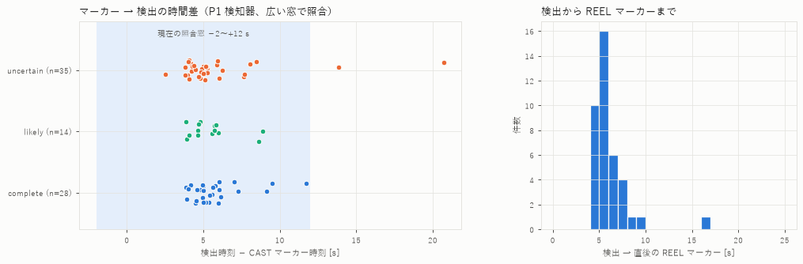

REEL マーカーを窓の上限に使う照合（`reel_bound_max_s`）との比較（P1 検知器）:

| 照合 | label | CAST | 一致 | 未検出 | 未照合の検出 |
|---|---|---|---|---|---|
| 固定窓 −2〜+12 | complete | 30 | 28 | 2 | 0 |
| 固定窓 −2〜+12 | likely | 15 | 14 | 1 | 0 |
| 固定窓 −2〜+12 | uncertain | 43 | 33 | 10 | 6 |
| REEL で上限（最大 30 s） | complete | 30 | 28 | 2 | 0 |
| REEL で上限（最大 30 s） | likely | 15 | 14 | 1 | 0 |
| REEL で上限（最大 30 s） | uncertain | 43 | 35 | 8 | 4 |

## 2. 見逃したキャストの特徴

baseline（|a|≥25）で complete / likely の CAST マーカー 45 本中 3 本を見逃し。照合窓内で |a| が最大の候補の特徴:

| session | label | marker_t | peak_t | offset | accel_peak | gyro_peak | post_gyro_mean |
|---|---|---|---|---|---|---|---|
| 10/25 10:44 | likely | 161.20 | 166.50 | 5.27 | 22.37 | 6.61 | 0.63 |
| 10/25 15:09 | complete | 475.30 | 484.60 | 9.26 | 23.11 | 8.17 | 2.72 |
| 10/25 15:09 | complete | 920.80 | 927.00 | 6.22 | 23.04 | 7.85 | 0.31 |

一致したキャスト（complete / likely、見逃し分を除く）の分布:

| stat | accel_peak | gyro_peak | post_gyro_mean |
|---|---|---|---|
| count | 42.00 | 42.00 | 42.00 |
| min | 25.78 | 5.79 | 0.09 |
| 5% | 26.57 | 6.05 | 0.09 |
| 50% | 32.46 | 7.73 | 0.17 |
| 95% | 40.56 | 10.21 | 0.69 |
| max | 42.39 | 10.51 | 1.23 |

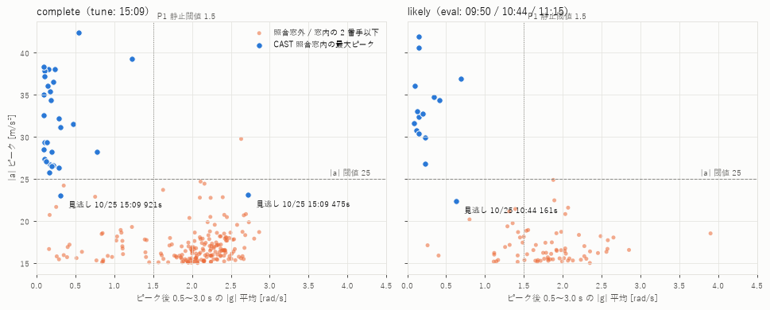

「照合窓外」の点は complete では非キャスト確定、likely では非キャストの可能性が高いもの。

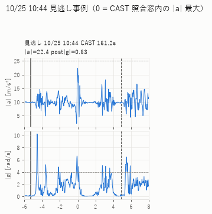

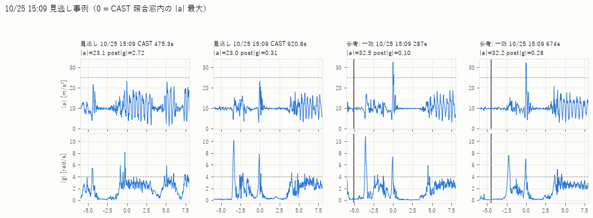

## 3. REEL マーカー後（リトリーブ中）の誤検知

区間: REEL マーカー +0.5 秒 〜 次の CAST マーカー −2 秒（次が無ければ +60 秒）。この区間に CAST は無い想定だが、likely / uncertain ではマーカー漏れの可能性があるため「誤検知候補」として数える。

| label | 区間数 | 合計秒 | baseline | P1 | P2 | 最大a_中央値 |
|---|---|---|---|---|---|---|
| likely | 15 | 678.70 | 0 | 0 | 1 | 17.72 |
| uncertain | 26 | 1250.50 | 0 | 0 | 0 | 18.08 |

baseline で検出があった区間:

（なし）
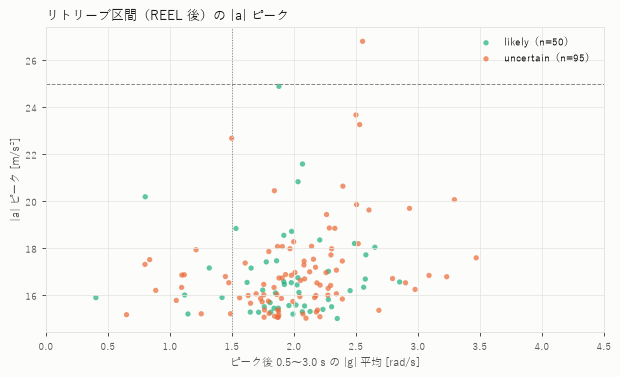

## 4. OTHER / WALK マーカー後の動作

各マーカーの −2〜+30 秒にある検出数（near_cast: ±15 秒以内に CAST マーカーあり）:

| session | label | type | t | max_accel | baseline | P1 | P2 | near_cast |
|---|---|---|---|---|---|---|---|---|
| 10/25 08:53 | none | OTHER | 150.00 | 26.30 | 1 | 0 | 0 | False |
| 10/25 08:53 | none | WALK | 1.30 | 23.84 | 0 | 0 | 0 | False |
| 10/25 08:53 | none | WALK | 175.20 | 26.30 | 1 | 0 | 0 | False |
| 10/25 09:13 | uncertain | OTHER | 427.10 | 17.77 | 0 | 0 | 0 | False |
| 10/25 09:13 | uncertain | OTHER | 1715.10 | 15.63 | 0 | 0 | 0 | False |
| 10/25 09:13 | uncertain | WALK | 1665.80 | 19.70 | 0 | 0 | 0 | False |
| 10/25 10:44 | likely | WALK | 261.50 | 20.83 | 0 | 0 | 1 | False |
| 10/25 10:50 | uncertain | OTHER | 71.10 | 15.21 | 0 | 0 | 0 | True |
| 10/25 10:50 | uncertain | OTHER | 71.90 | 15.21 | 0 | 0 | 0 | True |
| 10/25 10:50 | uncertain | WALK | 2.60 | 25.80 | 1 | 1 | 1 | False |
| 10/25 10:50 | uncertain | WALK | 615.20 | 21.75 | 0 | 0 | 1 | False |
| 10/25 11:02 | uncertain | WALK | 2.70 | 22.99 | 0 | 0 | 1 | False |
| 10/25 11:02 | uncertain | WALK | 643.80 | 23.26 | 0 | 0 | 0 | False |
| 10/25 11:15 | likely | WALK | 8.70 | 22.16 | 0 | 0 | 0 | False |
| 10/25 11:15 | likely | WALK | 344.90 | 15.90 | 0 | 0 | 0 | False |
| 10/25 15:09 | complete | OTHER | 453.60 | 21.68 | 0 | 0 | 1 | True |
| 10/25 15:09 | complete | OTHER | 575.70 | 15.95 | 0 | 0 | 0 | False |
| 10/25 15:09 | complete | OTHER | 1088.00 | 18.46 | 0 | 0 | 0 | False |

08:53（WALK マーカー付き・CAST なし、14.8 分）の検出数: baseline 11 件, P1 0 件, P2 1 件。|a|≥20 の候補 132 件のうち、ピーク後 |g| 平均 ≤1.5 は 5 件。このセッションは label=none なので誤検出とは確定しないが、歩行中の |a| ピークは 4 秒前後の周期で続き、ピーク後も |g| が 3〜4 rad/s のまま（腕振り）。

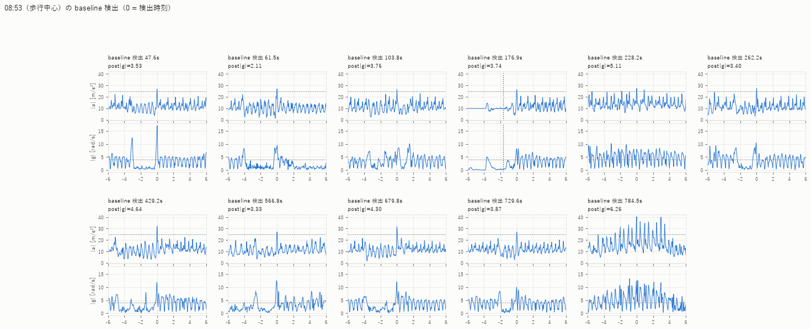

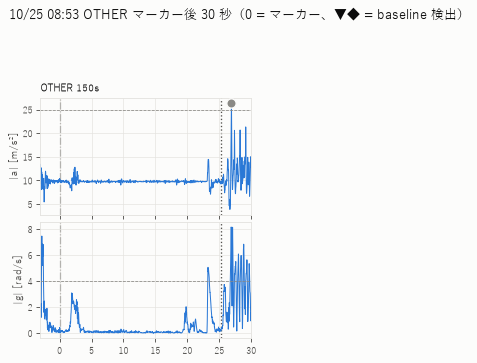

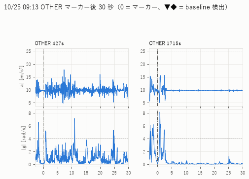

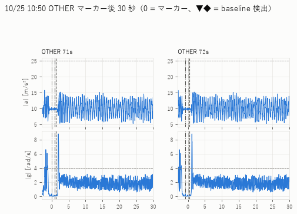

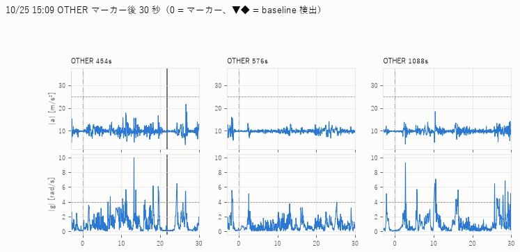

## 5. 11:34 セッション（実キャスト 2 回）の重点確認

マーカー: CAST 22.3s, REEL 49.9s, CAST 130.1s, REEL 149.8s（セッション 15.6 分）

baseline の検出と特徴（post_gyro_mean = ピーク後 0.5〜3.0 秒の |g| 平均）:

| t | accel_peak | gyro_peak | post_gyro_mean | P1 で残る | P2 で残る | 直後の REEL まで |
|---|---|---|---|---|---|---|
| 14.20 | 29.33 | 10.67 | 2.49 | False | False | — |
| 43.02 | 34.33 | 9.34 | 0.18 | True | True | 6.85 |
| 143.92 | 29.72 | 9.60 | 0.18 | True | True | 5.87 |
| 237.12 | 46.53 | 25.62 | 2.48 | False | False | — |
| 789.92 | 26.06 | 8.17 | 1.12 | True | False | — |
| 797.92 | 42.17 | 7.16 | 0.57 | True | True | — |
| 813.22 | 25.67 | 13.28 | 3.34 | False | False | — |
| 893.18 | 25.11 | 13.11 | 3.40 | False | False | — |
| 916.22 | 25.28 | 10.69 | 1.98 | False | False | — |

- baseline: 9 件 → 14.2s, 43.0s, 143.9s, 237.1s, 789.9s, 797.9s, 813.2s, 893.2s, 916.2s（実キャスト 2 回とすると、少なくとも 7 件は誤検出）
- P1: 5 件 → 43.0s, 143.9s, 238.3s, 789.9s, 797.9s（実キャスト 2 回とすると、少なくとも 3 件は誤検出）
- P2: 6 件 → 43.0s, 143.9s, 238.8s, 250.7s, 445.1s, 797.9s（実キャスト 2 回とすると、少なくとも 4 件は誤検出）

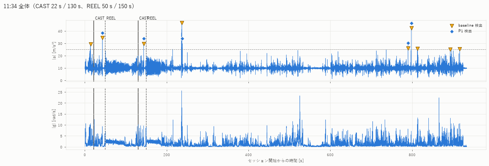

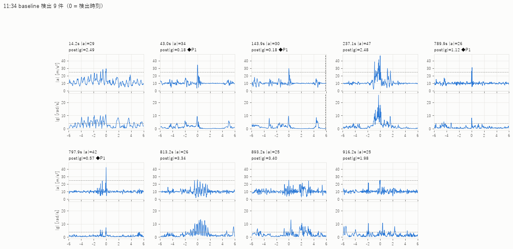

## 6. 調整用と評価用を分離した成績

調整（tune）: 10/25 15:09 のみ（label=complete）。P1 はこのセッションだけで決めた（F1 が下がらない範囲で最も厳しい静止閾値）。P2 は参考値で、評価用セッションの結果を見て選んではいない。

| 検知器 | 区分 | セッション | CAST | 一致 | 未検出 | 検出 | 未照合 | precision | recall | recall_ref | 検出/時 |
|---|---|---|---|---|---|---|---|---|---|---|---|
| baseline | tune (complete) | 1 | 30 | 28 | 2 | 28 | 0 | 1.00 | 0.93 | — | — |
| baseline | eval likely | 3 | 15 | 14 | 1 | 14 | 0 | — | — | 0.93 | — |
| baseline | eval uncertain | 6 | 43 | 33 | 10 | 45 | 12 | — | — | — | — |
| baseline | eval none | 4 | 0 | 0 | 0 | 28 | 28 | — | — | — | 49.51 |
| baseline | eval 11:34（件数既知 2） | 1 | 2 | 0 | 2 | 9 | 9 | — | — | — | — |
| P1 | tune (complete) | 1 | 30 | 28 | 2 | 28 | 0 | 1.00 | 0.93 | — | — |
| P1 | eval likely | 3 | 15 | 14 | 1 | 14 | 0 | — | — | 0.93 | — |
| P1 | eval uncertain | 6 | 43 | 33 | 10 | 39 | 6 | — | — | — | — |
| P1 | eval none | 4 | 0 | 0 | 0 | 16 | 16 | — | — | — | 28.29 |
| P1 | eval 11:34（件数既知 2） | 1 | 2 | 0 | 2 | 5 | 5 | — | — | — | — |
| P2 | tune (complete) | 1 | 30 | 29 | 1 | 32 | 3 | 0.91 | 0.97 | — | — |
| P2 | eval likely | 3 | 15 | 15 | 0 | 16 | 1 | — | — | 1.00 | — |
| P2 | eval uncertain | 6 | 43 | 34 | 9 | 45 | 11 | — | — | — | — |
| P2 | eval none | 4 | 0 | 0 | 0 | 20 | 20 | — | — | — | 35.36 |
| P2 | eval 11:34（件数既知 2） | 1 | 2 | 0 | 2 | 6 | 6 | — | — | — | — |

- precision / recall は complete（tune）のみ。tune の数値は調整に使ったデータでの成績で、汎化性能ではない
- likely は recall_ref（参考値）と未照合の件数のみ。uncertain / none は件数のみ
- 11:34 は CAST マーカーの位置がずれている（項目 1・5）ため、一致/未検出より「検出数 − 2」の方が意味を持つ

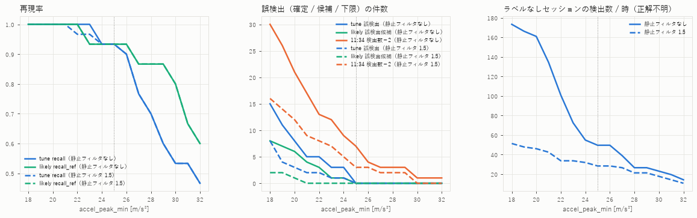

## 7. 検知間隔（min_interval_s = 8 秒）の影響

(a) 一致したキャスト 42 回のうち、±10 秒以内に |a|≥25 の副ピークがあったのは 8 回（最大距離 3.2 秒）。静止フィルタ（P1）を通すと 8 回（最大距離 0.4 秒）。

| session | cast_t | extra_peaks | max_dist | extra_peaks_P1 | max_dist_P1 |
|---|---|---|---|---|---|
| 10/25 10:44 | 60.40 | 1 | 0.06 | 1 | 0.06 |
| 10/25 11:15 | 111.90 | 1 | 0.06 | 1 | 0.06 |
| 10/25 15:09 | 287.30 | 1 | 0.08 | 1 | 0.08 |
| 10/25 15:09 | 450.40 | 7 | 3.22 | 5 | 0.44 |
| 10/25 15:09 | 1040.80 | 1 | 0.10 | 1 | 0.10 |
| 10/25 15:09 | 1436.00 | 1 | 0.10 | 1 | 0.10 |
| 10/25 15:09 | 1560.80 | 1 | 0.08 | 1 | 0.08 |
| 10/25 15:09 | 1732.80 | 1 | 0.04 | 1 | 0.04 |

(b) complete / likely の CAST マーカー間隔: 最小 25.3 秒、5% 点 38.3 秒。uncertain には 9.0 秒（09:13 の 1578 s → 1587 s）・1.0 秒（10:28）の間隔があるが、誤タップとの区別はつかない。

(c) min_interval_s を変えたときの件数:

| min_interval_s | 検知器 | tune 一致 | tune 誤検出 | likely 一致 | likely 誤検出候補 | none 検出 |
|---|---|---|---|---|---|---|
| 0 | baseline | 28 | 12 | 14 | 2 | 43 |
| 0 | P1 | 28 | 10 | 14 | 2 | 18 |
| 1 | baseline | 28 | 2 | 14 | 0 | 31 |
| 1 | P1 | 28 | 0 | 14 | 0 | 16 |
| 2 | baseline | 28 | 1 | 14 | 0 | 30 |
| 2 | P1 | 28 | 0 | 14 | 0 | 16 |
| 3 | baseline | 28 | 1 | 14 | 0 | 29 |
| 3 | P1 | 28 | 0 | 14 | 0 | 16 |
| 4 | baseline | 28 | 0 | 14 | 0 | 28 |
| 4 | P1 | 28 | 0 | 14 | 0 | 16 |
| 5 | baseline | 28 | 0 | 14 | 0 | 28 |
| 5 | P1 | 28 | 0 | 14 | 0 | 16 |
| 6 | baseline | 28 | 0 | 14 | 0 | 28 |
| 6 | P1 | 28 | 0 | 14 | 0 | 16 |
| 8 | baseline | 28 | 0 | 14 | 0 | 28 |
| 8 | P1 | 28 | 0 | 14 | 0 | 16 |
| 12 | baseline | 28 | 0 | 14 | 0 | 28 |
| 12 | P1 | 28 | 0 | 14 | 0 | 16 |

(d) 合成テスト: 15:09 の一致キャスト 28 回それぞれについて、ピーク −3〜+4 秒の波形を Δ 秒後に複製し、2 回として検出できた数（列 = Δ 秒）。複製元の直後に上書きするため、Δ が小さいと 1 回目の「ピーク後静止」区間も2 回目の振りで上書きされる点に注意（現実の連続キャストに近い）。

| 検知器 | min_interval_s | 3.0 | 4.0 | 5.0 | 6.0 | 7.0 | 8.0 | 10.0 |
|---|---|---|---|---|---|---|---|---|
| P1 | 3 | 0 | 9 | 26 | 27 | 27 | 27 | 27 |
| P1 | 5 | 0 | 0 | 26 | 27 | 27 | 27 | 27 |
| P1 | 8 | 0 | 0 | 0 | 0 | 0 | 27 | 27 |
| baseline | 3 | 16 | 27 | 27 | 27 | 27 | 27 | 27 |
| baseline | 5 | 0 | 0 | 27 | 27 | 27 | 27 | 27 |
| baseline | 8 | 0 | 0 | 0 | 0 | 0 | 27 | 27 |

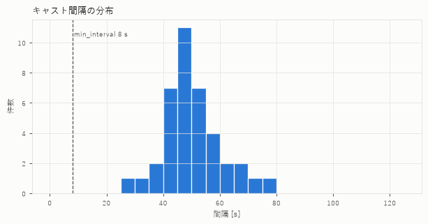

