# 実釣データ（2026-10-31）による P1 検知器の評価

> **追記（2026-11-01）**: 20:24 の釣り方（フリーリグ・意図的に弱いキャスト）と投数についての申告を受けて再評価した。
> 結果は [§11](#11-追加情報を踏まえた再評価2026-11-01-追記) にまとめた。要点:
> - 20:24 は加速度・角速度とも他より明らかに小さい（申告と一致）。加えて**回転の向きが通常のキャストと違う**ものが半数ある
> - \|a\| 閾値を 21 に下げる案（§9 の 1）は、10/31 では見逃しが 13 → 1 になるが、**未知データ（10/25）では歩行・単発動作の誤検知が増える**
> - 閾値を下げる代わりに「振りの回転方向」と「キャスト後の構え姿勢」を条件に加えると、10/25 でも誤検知を増やさずに見逃しを減らせた（案 C）。§9 の優先順位はこちらに置き換える
>
> **追記 2（2026-11-01）**: 20:06 の FALSE 申告 2 件（フックがバッグに刺さり外そうとしていたという申告）を [§12](#12-2006-の-false-申告-2-件フック外しの動作という申告2026-11-01-追記-2) で確認した。
> 2 件は 130 秒離れているが、どちらも釣り開始前の約 6 分間の「断続的な小さな動き」の中にあり、振りかぶりの無い単発の突き上げだった。案 C ではどちらも検出されない

- 対象: 根岸港 13:59 と鶴見川 19:39〜21:20 の **8 セッション**（計 146.8 分、CAST マーカー 99、AUTO_CAST 92）
- 対象外: 磯子海づり施設の 2 セッション（`session_20261031_153345` / `161120`）。アンダーキャスト指定で動作条件が違うため、集計・評価・改善案の根拠に使っていない。今後のアンダーキャスト検証用として別扱いにする
  - 同じ日の 02:31〜02:34 の 4 セッションと 13:54 のセッションも、指定外なので使っていない
- 検知器: ウォッチ上の P1（`params/default.json` と同じ値。meta の `detector_*` で確認）。**検知アルゴリズム・パラメータ・アプリは変更していない**
- 再現: `cd analysis; .\.venv\Scripts\python.exe studies\field_review_20261031.py`（§1〜10）、続けて `studies\field_review_20261031_followup.py`（§11、`followup_results.md` と `figures/fu_*.png`）
- 数値・図: [results.md](results.md)（スクリプトが生成）、CSV（`cast_markers.csv` / `auto_casts.csv` / `metrics.csv` ほか）は同じフォルダ

表記: **【確認】** = データまたは実装から確かめた事実、**【推定】** = 波形などから推し量ったもの（確認できていない）。

---

## 0. 前提の確認（FALSE・UNDO の意味、データの品質）

### FALSE / UNDO / MISS の実装上の意味【確認】

`app/.../events/SessionEventLog.kt` と `CounterScreen.kt` で確認した。

| イベント | 意味 | 対象の決め方 | 補正後投数への影響 |
|---|---|---|---|
| FALSE | 「キャストしていないのに自動カウンターが増えた」とユーザーが申告 | 画面に表示されている「まだ FALSE が付いていない最新の AUTO_CAST」。`ref_id` = その AUTO_CAST | −1 |
| UNDO | 直前の手動イベント（CAST / REEL / WALK / OTHER / MISS / FALSE）の取り消し。AUTO_CAST は取り消せない | 「まだ取り消されていない最新の手動イベント」。連続 UNDO で 1 件ずつさかのぼる | 対象が MISS / FALSE なら補正を戻す |
| MISS | 「キャストしたのにカウンターが増えなかった」 | — | +1 |

- 元のイベントは消えない（追記のみ）。castlab は events.csv の UNDO を反映してマーカーを作る（センサー CSV の `MARK_*` 行は UNDO 後も残る）
- **今回の FALSE / UNDO の実例**
  - 19:52 の UNDO（id 5）: `ref_id=3`（REEL）。REEL #2 の **0.3 秒後**に押された REEL #3 を取り消している → 二度押しの訂正【確認: 時刻差】
  - 20:06 の FALSE 2 件: #3 が AUTO #2（申告の 67 秒前）、#4 が AUTO #1（198 秒前）。2 回目は **1 回目の 1.1 秒後**に押されている。実装上、1 回目を押した時点で FALSE の対象が自動的に 1 つ前の AUTO #1 に移るため、**2 回目が「AUTO #1 も誤り」という意図か、二度押しかはデータからは区別できない**。ただし AUTO #1・#2 とも最初の CAST（351 秒）より前で、どちらもキャストらしい波形ではない（§3）ので、本レポートでは 2 件とも誤検知（申告）として扱う
- MISS は 0 件。未検知が 13 件あるので、**MISS ボタンは使われていない（または画面を見ていない）と考えられる**【推定】

### データ品質・実装一致【確認】

- 全セッションで加速度 50.4 Hz、0.2 秒を超える欠損なし
- PC で同じパラメータで再検知した結果は、ウォッチの AUTO_CAST 92 件と**時刻まで完全一致**（不一致 0）。Kotlin 版と Python 版の一致が実データでも確かめられた。以下の解析は AUTO_CAST をそのまま使う
- 確定遅延は 8.01〜8.08 秒（`delay_ms`）

---

## 1. セッション別サマリー【確認】

| セッション | 場所 | 記録 [分] | CAST | REEL | OTHER / WALK | AUTO_CAST | FALSE | UNDO | 補正後投数（ウォッチ） |
|---|---|---|---|---|---|---|---|---|---|
| 13:59 | 根岸港 | 11.9 | 10 | 10 | 0 | 9 | 0 | 0 | 9 |
| 19:39 | 鶴見川 | 11.6 | 11 | 11 | 0 | 11 | 0 | 0 | 11 |
| 19:52 | 鶴見川 | 12.6 | 13 | 13 | 0 | 11 | 0 | 1 | 11 |
| 20:06 | 鶴見川 | 16.7 | 10 | 10 | 0 | 12 | 2 | 0 | 10 |
| 20:24 | 鶴見川 | 18.0 | 6 | 7 | OTHER 1 | 2 | 0 | 0 | 2 |
| 21:02 | 鶴見川 | 8.2 | 5 | 5 | 0 | 4 | 0 | 0 | 4 |
| 21:19 | 鶴見川（移動） | 1.5 | 0 | 0 | WALK 2 | 0 | 0 | 0 | 0 |
| 21:20 | 鶴見川 | 66.2 | 44 | 41 | 0 | 43 | 0 | 0 | 43 |
| **計** | | **146.8** | **99** | **97** | 3 | **92** | 2 | 1 | 90 |

- CAST・REEL は UNDO 反映後の件数
- **CAST マーカーは 99 件**。当初の「120 投」は各セッションの目標投数から計算した値で、ユーザーの申告により **99 件のほうが実投数に近い**（CAST の押し忘れは、キャスト直後・巻く前に押して補完していた）。ただし少数の中止例を含みうる（§3）。REEL だけのキャストも少なくとも 1 件ある
- CAST 数と AUTO_CAST 数がほぼ同じセッション（19:52: 13 対 11、21:20: 44 対 43）でも、中身は「未検知」と「CAST のない検出」が相殺しているだけのことがある（21:20: 未検知 4・CAST と対応しない検出 3）。総数の一致は正しさを意味しない

---

## 2. イベント照合

### 照合方法

1. **1 段目**（既存の `sessions.toml [matching]`）: AUTO_CAST のピーク時刻が CAST 押下の **−2〜+12 秒**にあれば対応可能。CAST の後 30 秒以内（次の CAST より前）に REEL があれば窓の終わりを REEL にする。1 対 1（ハンガリアン法、+5 秒に近いものを優先）
2. **2 段目（今回追加。解析スクリプト内だけ）**: CAST の **3 秒以内に REEL** がある CAST は「事後入力」（キャスト後に CAST → 直後に REEL）とみなし、窓を **[−20 秒, REEL]** に広げる。1 段目で余ったものどうしだけを対応付ける

### 時間差【確認】

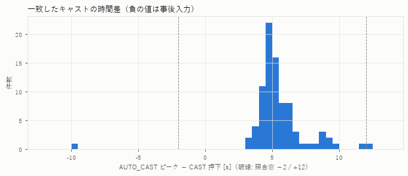

| | 件数 | 最小 | 25% | 中央値 | 75% | 最大 |
|---|---|---|---|---|---|---|
| AUTO ピーク − CAST 押下 [s] | 86 | −9.80（事後入力） | +4.59 | **+5.08** | +6.02 | +12.04 |

- 事後入力を除くと **+3.09〜+12.04 秒**。セッション別の中央値は 4.4〜5.6 秒で、20:06 は 75% 点が 7.6 秒とやや遅い
- ピーク → 直後の REEL は中央値 5.5 秒（3.5〜15.3 秒、n=83）
- **+12 秒を超えた例が 1 件**（21:20 の 312 秒、+12.04 秒）。固定窓 −2〜+12 だけでは照合できず、REEL 上限（REEL が +18.1 秒）があるので一致になった

### 照合窓の感度【確認】

一致数（CAST 99 件中）。詳細は `window_sweep.csv`。

| 窓の前側 | 後側 +8 | +10 | +12 | +15 | +20 | REEL 上限あり（後側によらず） |
|---|---|---|---|---|---|---|
| −2 / −5 秒 | 76 | 83 | 84 | 85 | 85 | 85 |
| −10〜−20 秒 | 77 | 84 | 85 | 86 | 86 | 86 |

- **REEL 上限を使うと、後側の幅によらず結果が安定する**（REEL の押し忘れが少ない今回のデータでは）
- 前側を −10 秒以上に広げて増える 1 件は、事後入力の 21:20 CAST 2336.5 秒（ピークは 9.8 秒前、REEL は CAST の 0.7 秒後）。2 段目の規則で同じ 1 件だけを拾える。前側を一律に広げるより、「CAST 直後に REEL」という事後入力のパターンに限るほうが、前のキャストの検出を誤って割り当てる危険が小さい
- 結論: **照合は「−2 秒〜REEL（REEL が無ければ +15 秒）」＋「事後入力パターンだけ −20 秒」**が今回のデータに合う

### 照合結果【確認】

| CAST マーカー（99） | 件数 |
|---|---|
| 一致（1 段目） | 85 |
| 事後入力で一致（2 段目） | 1 |
| 未照合 | **13** |

| AUTO_CAST（92） | 件数 |
|---|---|
| CAST と一致 | 86 |
| 誤検知（FALSE 申告） | 2 |
| CAST 押し忘れ推定（REEL のみ） | 1 |
| 曖昧（CAST の代わりに OTHER？） | 1 |
| 誤検知候補（前後 30 秒にマーカーなし） | 2 |

---

## 3. 誤検知・未検知の候補一覧

### 未照合の CAST（未検知候補）13 件

候補ピーク = CAST −2 秒〜REEL（無ければ +15 秒）で、静止フィルタなしの緩い候補抽出（|a|≥15）のうち、ジャイロ・静止条件を満たす中で |a| が最大のもの。

| セッション | CAST [s] | 候補ピーク（CAST から） | \|a\| | \|g\| ピーク | ピーク後静止 | 振りかぶり | 落ちた条件 | 分類 |
|---|---|---|---|---|---|---|---|---|
| 13:59 | 392.6 | +4.7 | 23.6 | 8.4 | 0.14 | 9.9 | \|a\| | 弱いキャスト |
| 19:52 | 483.7 | +5.6 | 24.2 | 8.5 | 1.18 | 4.6 | \|a\| | 弱いキャスト・短周期（次の CAST まで 24 s） |
| 19:52 | 640.2 | +5.2 | 21.8 | 8.6 | 0.13 | 4.5 | \|a\| | 弱いキャスト |
| 20:24 | 298.1 | +8.6 | 21.2 | 5.7 | 0.32 | 5.8 | \|a\| | 弱いキャスト |
| 20:24 | 420.9 | +6.8 | 21.4 | 7.1 | 0.24 | 6.0 | \|a\| | 弱いキャスト |
| 20:24 | 538.8 | +5.7 | 23.0 | 7.0 | 0.10 | 2.8 | \|a\| | 弱いキャスト |
| 20:24 | 949.3 | +8.9 | **17.1** | 4.3 | 0.28 | 5.1 | \|a\| | 弱いキャスト（極端に弱い） |
| 20:24 | 1044.5 | +5.3 | 23.1 | 7.1 | 0.37 | 4.7 | \|a\| | 弱いキャスト |
| 21:02 | 191.1 | +4.3 | 21.7 | 7.4 | 0.94 | 7.1 | \|a\| | 弱いキャスト・短周期（24 s） |
| 21:20 | 1466.2 | +10.8 | 24.8 | 7.6 | 0.21 | 6.0 | \|a\| | 弱いキャスト |
| 21:20 | 1814.4 | +4.1 | 22.1 | 6.9 | 1.14 | 10.0 | \|a\| | **中止・やり直し候補**（REEL なしで 28 s 後に次の CAST） |
| 21:20 | 1938.3 | +6.3 | 21.3 | 5.7 | 1.34 | 4.5 | \|a\| | 弱いキャスト・短周期（29 s） |
| 21:20 | 2879.1 | +11.7 | 22.4 | 7.3 | 0.12 | 4.4 | \|a\| | 弱いキャスト |

（単位: \|a\| m/s²、\|g\| rad/s。ピーク後静止 = ピーク後 0.5〜3 s の \|g\| 平均、閾値 1.5。振りかぶり = ピーク 4〜1 s 前の \|g\| 最大）

- 【確認】**13 件すべてが「\|a\| が閾値 25 未満」だけで落ちている**。\|g\| ピーク条件（≥4）とピーク後静止条件（≤1.5）は全件満たしている（20:24 の 949 秒だけ \|g\| 4.3 で境界付近）
- 【確認】13 件中 5 件が 20:24。20:24 は 6 回中 5 回が未検知
- 【推定】波形（下図）は一致したキャストと同じ「振りかぶり → 鋭いピーク → 2〜3 秒の静止 → 巻き取り」の形で、**キャスト自体は行われているが振りが弱い**と考えられる。動作の失敗ではなく、検知器の \|a\| 閾値が高すぎる
- 【推定】短周期の 3 件（24〜29 秒で次の CAST）と 21:20 1814 秒（REEL なし）は、失敗キャスト（着水点が悪い・ライントラブル）の後のやり直しかもしれない。ただし CAST は押されているので、ここではキャストとして数えている。1814 秒だけは REEL が無いので「中止候補」として Recall の分母から除いた値も出す（§6）

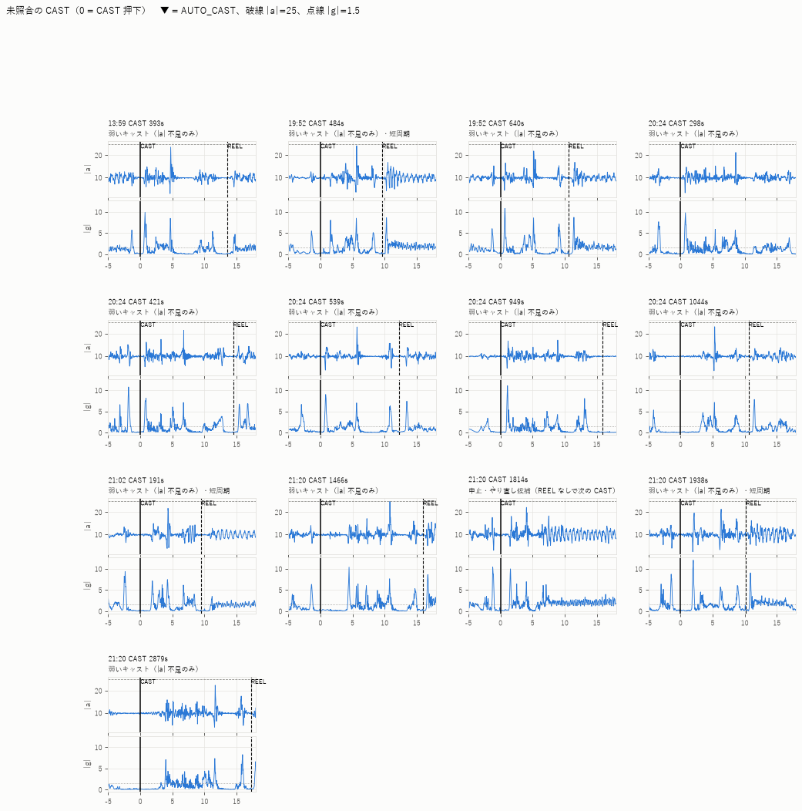

### CAST と対応しない AUTO_CAST 6 件

| セッション | AUTO id | ピーク [s] | \|a\| | \|g\| | 静止 | 振りかぶり | 周辺マーカー | 分類 | 判断 |
|---|---|---|---|---|---|---|---|---|---|
| 20:06 | 1 | 129.8 | 25.5 | **4.8** | 0.72 | 2.5 | なし（最初の CAST は 351 s） | 誤検知（FALSE 申告） | 【確認】申告あり。単発の鋭いスパイクのみ |
| 20:06 | 2 | 260.1 | 36.0 | 8.2 | 0.45 | 5.2 | なし | 誤検知（FALSE 申告） | 【確認】申告あり。前に小さな \|g\| の山、巻き取りが続かない |
| 20:24 | 12 | 819.9 | 26.0 | 7.3 | 1.01 | 3.4 | OTHER +4.8 s、REEL +7.2 s | 曖昧 | 【推定】ピーク → 静止 → REEL 後に巻き取りの周期波形が続く。CAST の代わりに OTHER を押した（隣のボタン）可能性があるが確認できない |
| 21:20 | 82 | 2042.5 | 27.6 | **4.9** | 0.23 | 2.1 | なし（前後 30 s） | 誤検知候補 | 【推定】単発スパイクだが、+4 秒から巻き取りに似た周期波形が続く。CAST・REEL ともに押し忘れたキャストの可能性も残る |
| 21:20 | 101 | 2758.7 | 27.6 | 7.8 | 1.30 | **0.3** | なし | 誤検知候補 | 【推定】10 秒以上ほぼ静止していた腕に単発の衝撃。振りかぶりも巻き取りも無く、キャストらしくない（前回レビューの 11:34 797.9 s と同じ型） |
| 21:20 | 122 | 3429.5 | 33.1 | 9.5 | 0.16 | 3.4 | REEL +5.6 s（CAST なし） | CAST 押し忘れ推定 | 【推定】ピーク → 静止 → REEL → 巻き取りの典型。正しい検知の可能性が高い |

- 【確認】**移動中（21:19、WALK、\|a\| 35〜45 のピークが連続）の検出は 0 件**。ピーク後静止フィルタがすべて落とした
- 【確認】21:20 の 1600 秒（\|a\| 44、\|g\| 19.7）や 3246 秒（\|a\| 38）のような強い動きも、ピーク後の \|g\| 平均が 1.96 / 2.34 で除外されている（マーカーなし。何の動作かは不明）
- 【確認】FALSE 申告 2 件のうち 1 件と誤検知候補 2042.5 秒は、\|g\| ピークが 4.8〜4.9 と低い。一致したキャスト 86 件の \|g\| ピークは **最小 6.4**（5% 点 8.6）

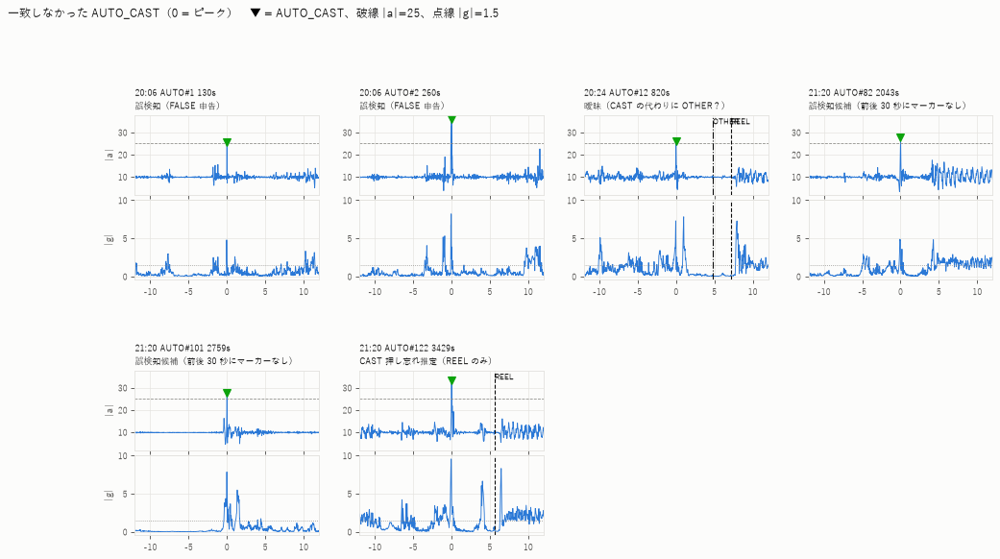

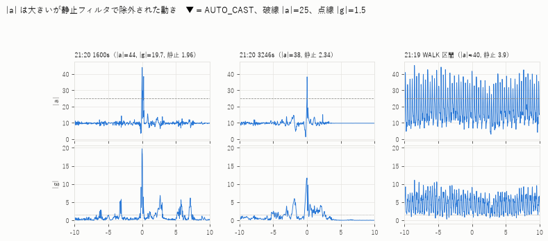

---

## 4. 特徴的なセンサー波形

### 典型的なキャストと 20:24 の弱いキャスト

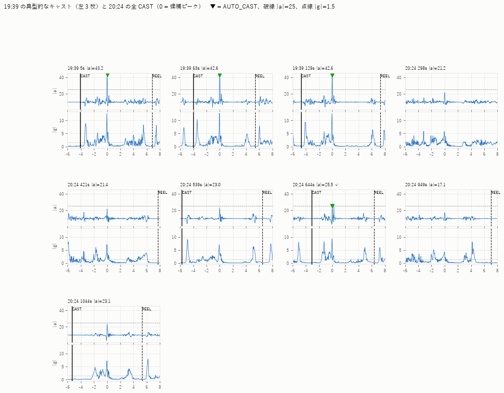

- 典型（19:39）: CAST 押下の約 4 秒後に \|a\| 40 超の鋭いピーク、\|g\| 12〜13 rad/s、ピーク後 2〜3 秒ほぼ静止、その後 REEL と巻き取り
- 20:24: **形は同じだが、\|a\| ピークは 17〜23、\|g\| ピークも 4〜7 と小さい**。CAST からピークまでも 5〜9 秒と長め
- 【申告 → 波形で裏付け】20:24 はフリーリグ＋クレイジーフラッパーで、ワームのずれと根掛かりを避けるため、**意図的に弱く・近距離に投げていた**。§11.1 で、\|a\|・\|g\|・振りの回転量がいずれも他のセッションより小さいことを確かめた。**検知器の性能差というより、計測条件（投げ方）の違いが集計に出ている**。ただし、それを吸収できていないのは検知器の弱点でもある

### 特徴量の分布

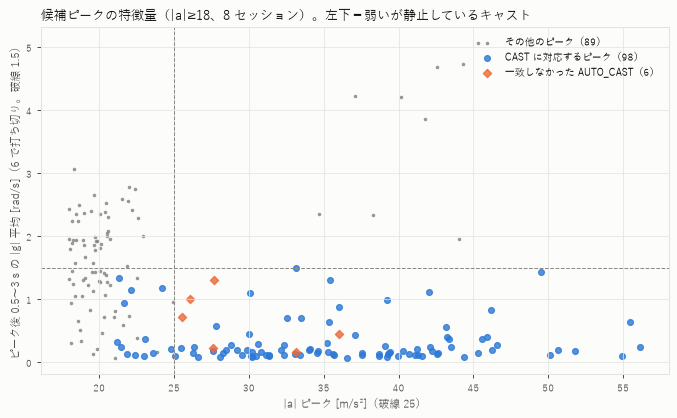

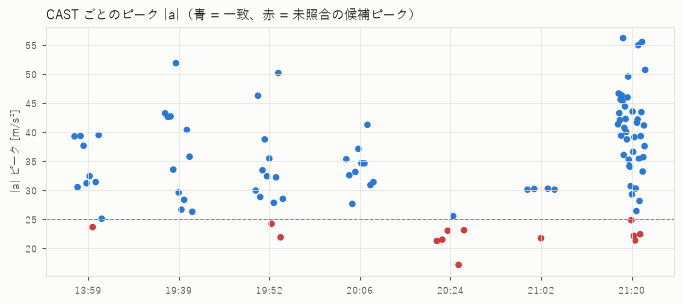

- 【確認】CAST に対応するピーク（98 件）は、ほぼ全件がピーク後静止 ≤ 1.5（静止フィルタと矛盾しない）
- 【確認】「\|a\| 21〜25 かつ静止 ≤ 1.5」の領域には、見逃したキャスト 12 件に対して、CAST と対応しないピークが 8 件ある（うち 2 件は \|g\| < 4 で現行のジャイロ条件でも落ちる）。閾値を下げると、この 8 件の一部が新たな検出になる。\|a\| 18〜22 で静止 > 1.5 の灰色点は、巻き取り・操作の動き
- 一致したキャスト 86 件: \|a\| 25.0〜56.1（中央値 35.9）、\|g\| 6.4〜17.3（中央値 11.4）、静止 0.07〜1.50（中央値 0.18）、振りかぶり 1.9〜12.2（中央値 8.4）

---

## 5. 長時間セッション（21:20、66 分）の安定性

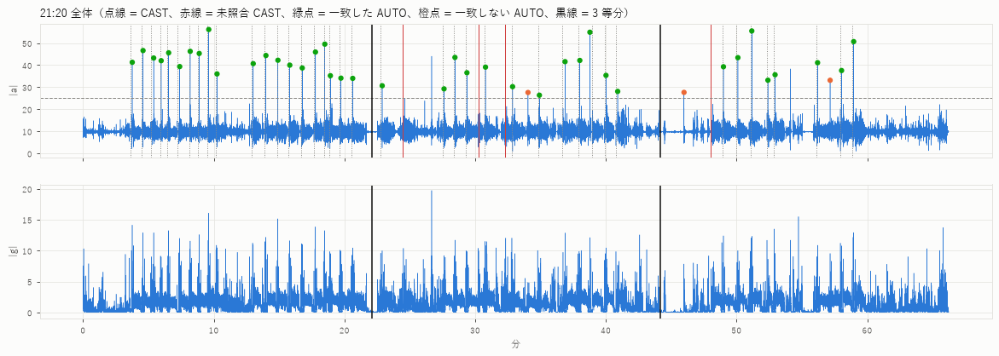

| 区間 | 範囲 [分] | CAST | 一致 | Recall | AUTO | 対応しない AUTO | 一致 \|a\| 中央値 | 一致 \|a\| 最小 | 時間差 中央値 | 静止 中央値 | CAST 間隔 中央値 [s] |
|---|---|---|---|---|---|---|---|---|---|---|---|
| 前半 | 0–22 | 20 | 20 | 1.00 | 20 | 0 | 42.1 | 34.0 | 5.5 | 0.20 | 49 |
| 中盤 | 22–44 | 15 | 12 | 0.80 | 13 | 1 | 35.9 | 26.4 | 5.4 | 0.22 | 61 |
| 後半 | 44–66 | 9 | 8 | 0.89 | 10 | 2 | 40.2 | 33.2 | 5.5 | 0.17 | 65 |

- 【確認】時間差・ピーク後静止は 3 区間でほぼ同じ。**検知器の振る舞い（遅延・静止判定）は時間経過で変わっていない**
- 【確認】中盤は一致したキャストの \|a\| が下がり（中央値 42 → 36、最小 26.4）、未検知 3 件（1466 / 1814 / 1938 秒）が集中した。後半は \|a\| が戻っている
- 【推定】単純な疲労なら後半も下がるはずなので、中盤の低下は投げ方・狙う距離・ルアーの変更など、その時間帯の条件によるものと考えられる。22 分付近と 44〜46 分付近にはウォッチがほぼ静止した区間があり、休憩や場所移動などがあったかもしれない（記録なし）
- 【確認】キャスト頻度は前半ほど高い（間隔 49 秒 → 65 秒）

---

## 6. Precision / Recall / F1（暫定値）

**すべて暫定値**。CAST は正解として扱うが、事後入力・押し忘れ・中止の可能性があり、未照合の検出が誤検知かどうかは FALSE 申告分以外は確定しないため。

- TP = CAST と一致（事後入力を含む）、FN = 未照合の CAST
- Precision 下限: CAST と対応しない AUTO_CAST をすべて誤検知とする
- Precision 上限: FALSE 申告だけを誤検知とする（REEL のみ・曖昧・マーカーなしは正しい検知の可能性を残す。この場合 F1 上限ではそれらを TP に足す）
- Recall（中止除く）: 21:20 1814 秒の「中止候補」を分母から除く

| セッション | CAST | TP | FN | AUTO | 対応しない AUTO（うち FALSE） | Recall | Precision 下限〜上限 | F1 下限〜上限 |
|---|---|---|---|---|---|---|---|---|
| 13:59 | 10 | 9 | 1 | 9 | 0 | 0.90 | 1.00 | 0.95 |
| 19:39 | 11 | 11 | 0 | 11 | 0 | 1.00 | 1.00 | 1.00 |
| 19:52 | 13 | 11 | 2 | 11 | 0 | 0.85 | 1.00 | 0.92 |
| 20:06 | 10 | 10 | 0 | 12 | 2（2） | 1.00 | 0.83 | 0.91 |
| 20:24 | 6 | 1 | 5 | 2 | 1（0） | **0.17** | 0.50〜1.00 | 0.25〜0.44 |
| 21:02 | 5 | 4 | 1 | 4 | 0 | 0.80 | 1.00 | 0.89 |
| 21:19（移動） | 0 | 0 | 0 | 0 | 0 | — | — | — |
| 21:20 | 44 | 40 | 4 | 43 | 3（0） | 0.91（中止除く 0.93） | 0.93〜1.00 | 0.92〜0.96 |
| **計** | **99** | **86** | **13** | **92** | 6（2） | **0.87**（中止除く 0.88） | **0.93〜0.98** | **0.90〜0.92** |
| 計（20:24 除く） | 93 | 85 | 8 | 90 | 5（2） | 0.91（中止除く 0.92） | 0.94〜0.98 | 0.93〜0.95 |

- 誤検知は少なく（確定 2 件、最大でも 6 件 / 2.4 時間）、**主な課題は Recall（弱いキャストの見逃し）**
- セッション件数が少ない（4〜13 件）ので、セッション別の値は 1 件で 0.1〜0.2 動く。セッション間の比較には向かない

---

## 7. 前回レビュー（2026-10-25 データ）との比較

[2026-10-25_detector_review](../2026-10-25_detector_review/README.md) との比較。前回の数値は P1 適用前後のもの、今回は P1 をウォッチ上で動かした実測。

| 項目 | 前回（10/25） | 今回（10/31） | 評価 |
|---|---|---|---|
| CAST → ピークの時間差 | +3.8〜+11.75 s（中央値 +5.2） | +3.1〜+12.04 s（中央値 +5.1）、事後入力 1 件（−9.8） | 再現。+12 を超える例が出たので、REEL 上限（改善案 3）が必要だったことが確かめられた |
| 見逃しの原因 | 弱いキャスト（\|a\| 22〜23）2 件、窓内最大がキャストでない 1 件 | **全 13 件が弱いキャスト（\|a\| 17〜24.8）** | 前回の「閾値 25 のすぐ下に弱いキャストが一定数ある」が、実釣では 13% に拡大。前回保留した改善案 4（閾値を下げる）の根拠がそろってきた |
| Recall | tune 28/30（0.93）、likely 14/15（0.93） | 86/99（0.87）、20:24 を除くと 0.91 | 条件によって大きく下がる（20:24: 0.17） |
| 歩行 | 08:53 で baseline 11 件 → P1 0 件 | 21:19（移動）で 0 件 | 静止フィルタ（改善案 1）の効果が実釣でも確認できた |
| 単発の衝撃 | 11:34 の 789.9 / 797.9 s（振りかぶり無し） | 21:20 2758.7 s（振りかぶり 0.3）、FALSE #1 | 同じ型の誤検知が残っている。前回提案の「振りかぶり」「\|g\| 上限」はまだ未採用 |
| 激しすぎる動き | 11:34 238 s（\|g\| 25.6）が検出 | 21:20 1600 s（\|g\| 19.7）は静止フィルタで除外 | 今回は問題にならなかった |
| 近接キャスト | 最小間隔 25.3 s。8 s で潰れた例なし | 最小 CAST 間隔 23.8 s。潰れた例なし | `min_interval_s=5` で問題なし |

---

## 8. 検出器の現状評価

- **誤検知への強さは十分**: 歩行・移動・巻き取り・強い衝撃のほとんどを静止フィルタが落としている。確定した誤検知は 2 件（20:06、最初の CAST 前の準備中）。それ以外で CAST と対応しない検出は 2.4 時間で 4 件（うち前後 30 秒にマーカーが全く無いのは 2 件）
- **見逃しが主な課題**: Recall 0.87。見逃しはすべて「形はキャストだが \|a\| が 25 に届かない」もの。投げ方が弱いセッション（20:24）では、ほぼ機能しなかった
- **時間的な安定性は問題なし**: 66 分のセッションで遅延・静止判定は一定。Recall の変動は振りの強さの変動で説明できる
- **実装**: ウォッチと PC の結果が完全一致し、確定遅延も設計どおり約 8 秒

---

## 9. 改善案（優先順位つき。いずれも未実装）

> **§11 の再評価で更新**: 下の案 1（閾値だけを下げる）は、未知データ（10/25）で歩行・単発動作の誤検知が増えた。
> 優先度 1 位は §11.5 の「\|a\| 21 ＋ 回転方向 ＋ 姿勢」（案 C）に置き換える。以下の案 1 は比較のために残す。

### 1. \|a\| 閾値を下げる（ジャイロ条件を少し上げて誤検知を抑える）— 優先度 高 → **§11 で格下げ**

今回のデータでの試算（`whatif_threshold.csv`。**このデータを見て選んだ値なので、このデータでの成績は楽観的**）:

| accel_peak_min | gyro_peak_min | 静止 | TP | FN | 対応しない検出 | うち FALSE 対象 | 移動中 | Recall |
|---|---|---|---|---|---|---|---|---|
| 25（現行） | 4 | 1.5 | 86 | 13 | 6 | 2 | 0 | 0.87 |
| 22 | 5.5 | 1.5 | 93 | 6 | 7 | 1 | 0 | 0.94 |
| **21** | **5.5** | 1.5 | **98** | **1** | **8** | 1 | 0 | **0.99** |
| 21 | 4 | 1.5 | 98 | 1 | 11 | 2 | 0 | 0.99 |
| 20 | 4 | 1.5 | 98 | 1 | 19 | 2 | 0 | 0.99 |
| 25 | 6 | 1.5 | 86 | 13 | 4 | 1 | 0 | 0.87 |

- \|a\| 21 まで下げると見逃し 13 → 1（残るのは \|a\| 17 の 20:24 949 秒）。20 まで下げると対応しない検出が急に増える
- \|g\| ピーク下限を 4 → 5.5 にすると、単発スパイク型（FALSE #1、2042.5 秒）が落ち、キャストは失わない（一致キャストの \|g\| 最小 6.4、見逃しの候補ピークも 20:24 949 秒以外は 5.69 以上。6 にすると 5.69 / 5.71 の 2 件を失う）
- \|a\| 21 で増える「対応しない検出」には、CAST 直前の準備動作（21:20 3357.8 s）や、CAST 間隔が 3 分空いた区間のキャストらしい波形（21:20 1568.6 s、静止 0.17）も含まれ、すべてが誤検知とは限らない
- **進め方**: 10/31 の 8 セッションを `tune` 用にし、次回の実釣データ（できれば `complete`）を `eval` にして確かめる。tune 用の 10/25 15:09 と合わせて調整し、`sessions.toml` の分離ルールを守る

### 2. 評価基盤の整備（照合規則・セッション設定）— 優先度 高

- castlab の照合に「事後入力」規則（CAST の 3 秒以内に REEL → 窓を [−20 s, REEL]）を入れる。今回の解析スクリプトでは実装済み、castlab 本体は未変更
- `sessions.toml` に 10/31 の 8 セッションを追加する（案: `label = "likely"`、上記のとおり `role = "tune"`）。21:19 は `none`
- 磯子の 2 セッションは、通常の評価に混ざらないよう別扱いにする（例: `ignore = true` と「アンダーキャスト検証用」の注記。または専用の役割を設ける）

### 3. 単発の衝撃による誤検知への対策 — 優先度 中

- 案 1 の \|g\| 下限の引き上げで、一部（\|g\| 5 未満のもの）は落ちる
- 振りかぶり（ピーク 4〜1 秒前の \|g\| 最大）は、誤検知候補 2758.7 秒が 0.3 と低い一方、一致したキャストにも 1.9〜2.9 が 3 件あり、単独の閾値では分けられない。complete データが増えてから再検討する
- 今回の確定誤検知は 2 件だけで、対策の効果を評価できるだけの件数がない

### 4. 弱い・やさしいキャストの扱いを決める — 優先度 中

- 20:24 のように \|a\| 17〜23 のキャストばかりのセッションがある。ちょい投げ・ピッチング・軽いルアーなどを数える対象にするか、決めておく必要がある
- 数えるなら、固定閾値ではなく「ピーク後静止」を主な条件にし、\|a\| 閾値は下げる方向（案 1）。装着者ごと・タックルごとの調整（キャリブレーション）は、その後の検討とする

### 5. 手動ボタンの操作ミスを減らす（UI）— 優先度 低

- FALSE を続けて押すと、2 回目が自動的に 1 つ前の AUTO_CAST に付く（20:06 で 1.1 秒差で発生）。続けて押したときは確認を挟む、または対象の経過時間を表示する
- CAST と OTHER の押し間違いの可能性（20:24 819.9 秒）。今回は確認できないので、次回の記録で確かめる

### 変えなくてよいもの

- `min_interval_s = 5`: 最小 CAST 間隔 23.8 秒で、潰れたキャストはない
- ピーク後静止フィルタ（0.5〜3.0 秒、1.5 rad/s）: 一致したキャストの最大が 1.50 で境界ぎりぎりの例が 1 件あるが、見逃しの原因になったものはない。歩行・強い動きの除外に効いている

---

## 10. 次回のフィールドテストで追加したい記録

1. **セッションごとのメモ**（`sessions.toml` の `note` に転記する）: 場所、タックル（ロッド・ルアー / オモリの重さ）、投げ方（オーバーヘッド / サイド / アンダー / ピッチング）、狙った距離、装着腕。20:24 のような条件差を説明できるようにする
2. **1 セッションは complete で記録**: 全キャストで CAST を押し、押し忘れがあればその場で MISS / メモで残す。Precision を確定できる唯一の方法
3. **キャスト中止・やり直しの記録**: 中止したときは CAST の直後に OTHER を押すなど、ルールを決めておく（UI を変えなくても運用でできる）
4. **事後入力の記録**: 今回の「キャスト後に CAST → すぐ REEL」の運用は、照合で見分けられたのでそのまま続けてよい。REEL だけ押した場合も、そのまま残してよい（REEL のみのキャストとして扱える）
5. **MISS / FALSE を使う**: 今回 MISS は 0 件だが未検知は 13 件あった。振動が来なかったときに MISS を押すと、未検知の確認が速くなる
6. **キャスト以外の大きな動作に OTHER**: 魚の取り込み、ルアー交換、根掛かり外しなど。21:20 1600 s / 3246 s のような強い動きの正体を確かめられる
7. **休憩・移動で WALK**、長時間の中断ではセッションを分ける
8. アンダーキャストは今回と同様に別セッションで記録し、セッション名をメモしておく

---

## 11. 追加情報を踏まえた再評価（2026-11-01 追記）

### 追加情報（ユーザー申告。実釣時の記憶に基づく）

- 20:24 はフリーリグ＋クレイジーフラッパー。ワームの刺し穴が傷んでいてずれやすく、また底の牡蠣殻での根掛かりを避けるため、**意図的に弱く・近距離に投げていた**
- 「目標 120 投」は目標投数からの計算で、**CAST 99 件のほうが実投数に近い**。押し忘れはキャスト直後・巻く前に CAST を押して補完した。少数の中止例を含む
- REEL は押し忘れが多く、正解としての信頼性は CAST より低い

### 使ったデータと「最適化」と「予測」の区別

| 用途 | データ | 注意 |
|---|---|---|
| \|a\| 閾値 21 の選定 | 10/31（本レポートの 8 セッション） | 10/31 での成績は**楽観的**（このデータを見て選んだ） |
| 回転方向・姿勢のテンプレートと閾値 | 10/25 15:09（tune, complete）のみ | 10/31 はこの閾値を決めるのに使っていない。ただし「回転方向がそろう」ことに気づいたのは 10/31 の波形を見たとき |
| 未知データでの予測の目安 | 10/25 の残り 13 セッション（likely 3・uncertain 6・none 4、歩行 08:53 を含む）と、10/31 のセッション単位の交差検証 | 10/25 は P1 の設計に使ったので、P1 自身にとっては完全な未知データではない。15:09 は案 B〜E にとっては学習データ |

- 再現: `studies/field_review_20261031_followup.py`。数値の全体は [followup_results.md](followup_results.md)、CSV は `fu_*.csv`
- 「回転方向」= \|a\| ピーク −0.3〜+0.1 秒で \|g\| が最大の時点の角速度ベクトルと、15:09 の平均ベクトル (−0.89, +0.04, +0.46) とのコサイン。左腕装着で、振り下ろしの瞬間に x 軸まわり負・z 軸まわり正に回る
- 「姿勢」= ピーク後 0.5〜3 秒の加速度平均（静止中の重力の向き）と、15:09 の平均 (+0.31, −0.95, +0.05) とのコサイン。キャスト直後にロッドを構えた手首の向き
- 閾値は 15:09 の一致キャスト 28 件の分布から、**回転方向 ≥ 0.8**（28 件中 27 件が 0.89 以上）、**姿勢 ≥ 0.85**（最小 0.90）とした

### 11.1 20:24 は他のセッションより加速度・角速度が小さいか → **小さい【確認】**

各 CAST に対応するピーク（未検知は §3 の候補ピーク）の特徴量。p 値は Mann–Whitney U（20:24 は 6 件なので目安）。

| 特徴量 | 20:24（n=6）中央値（範囲） | 他（n=93）中央値（範囲） | 他の未検知（n=8）中央値 | p 値 |
|---|---|---|---|---|
| \|a\| ピーク [m/s²] | **22.2**（17.1〜25.5） | 35.3（21.3〜56.1） | 22.2 | 2.7e-6 |
| \|g\| ピーク [rad/s] | **7.0**（4.3〜9.2） | 11.0（5.7〜17.3） | 7.5 | 1.5e-5 |
| 振りの回転量（ピーク −1.0〜+0.3 s の \|g\| 積分）[rad] | **2.9**（2.3〜3.7） | 4.0（2.1〜5.0） | 3.3 | 4.3e-4 |
| 振りかぶり（ピーク 4〜1 s 前の \|g\| 最大）[rad/s] | 5.5 | 8.3 | 5.3 | 0.026 |
| 回転方向の一致度 | **0.80**（−0.27〜0.99） | 0.99（−0.05〜1.00） | 0.98 | 0.009 |
| ピーク後静止 [rad/s] | 0.26 | 0.18 | 0.57 | 0.42 |
| 静止の長さ [s] | 3.1 | 3.5 | 2.9 | 0.88 |
| CAST → ピーク [s] | 6.2 | 5.1 | 5.4 | 0.21 |

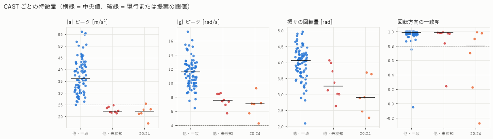

- 【確認】20:24 は \|a\|・\|g\|・振りの回転量・振りかぶりのいずれも他のセッションより小さい。**申告（意図的に弱く投げた）とセンサー波形は一致する**
- 【確認】20:24 の 6 投中 3 投（298 / 421 / 949 秒）は**回転の向きも通常と違う**（一致度 0.70 / 0.22 / −0.27）。下図のとおり、典型的なキャストの「x 負・z 正の鋭い山」が無く、y 軸まわりの回転が目立つ。弱いだけでなく、**振り方そのものが違う**【推定: 手首だけで送り出す・下から振るなど、動作の具体的な中身は波形からは分からない】
- 【確認】ピーク後の静止（キャスト後に構えて止まる動き）は他と同じようにある。検知器の静止フィルタは 20:24 でも問題なく働いている
- 【確認】巻き取り中（REEL +1〜+30 s）の \|g\| 平均も 20:24 は 0.87 rad/s で、他（1.1〜1.9）より小さい。フリーリグをゆっくり底で引く釣り方と矛盾しない【推定】
- 【確認できない】「近距離を探っていた」ことは、静止の長さ・CAST → ピーク・ピーク → REEL の時間に差がなく、波形からは確かめられない（フリーリグは着底を待つので、飛距離が短くても巻き始めは早くならない）

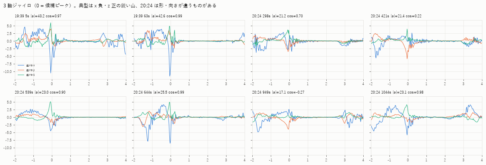

### 11.2 未検知キャストに共通する特徴

| グループ | n | \|a\| 中央値 | \|g\| 中央値 | 回転量 中央値 | 回転方向 ≥ 0.8 | 姿勢 ≥ 0.85 | 静止 ≤ 1.5 | 振りかぶり 中央値 | 短周期（< 35 s） |
|---|---|---|---|---|---|---|---|---|---|
| 他・一致 | 85 | 36.0 | 11.6 | 4.07 | 83/85 | 84/85 | 85/85 | 8.4 | 4/85 |
| 他・未検知 | 8 | 22.2 | 7.5 | 3.26 | 7/8 | 8/8 | 8/8 | 5.3 | **4/8** |
| 20:24（フリーリグ） | 6 | 22.2 | 7.0 | 2.91 | **3/6** | 6/6 | 6/6 | 5.5 | 0/6 |

- 【確認】全未検知に共通するのは「**振りが小さい**」こと: \|a\| 17〜25、\|g\| 4〜9（一致キャストは 6.4〜17）、振りかぶりも弱い。一方で**ピーク後の静止と構えの姿勢は、一致キャストと同じ**（13 件全件が静止 ≤ 1.5・姿勢 ≥ 0.85）
- 【確認】20:24 以外の未検知 8 件は、回転の向きも通常どおり（8 件中 7 件が ≥ 0.8）。同じ投げ方を弱くしたもの。外れた 1 件は 21:20 1814 秒の「中止・やり直し候補」（一致度 0.25）で、**中止した振りは向きも崩れている**可能性がある【推定】
- 【確認】20:24 以外の未検知 8 件の半数は、次の CAST まで 35 秒未満（一致キャストでは 85 件中 4 件）。やり直しの前の失敗キャストや、軽く投げ直した場面が多いと考えられる【推定】
- 【確認】20:24 の未検知は短周期ではなく（間隔は約 2 分）、釣り方による一貫した弱さ

### 11.3 \|a\| 閾値 25 → 21 の寄与

**(a) 10/31 で選んだ値を 10/31 に当てた結果（最適化の結果。楽観的）**。\|g\| ≥ 4・静止 ≤ 1.5 は現行のまま。

| 対象 | CAST | TP（25） | TP（21） | 対応しない検出（25） | 対応しない検出（21） |
|---|---|---|---|---|---|
| 20:24（フリーリグ） | 6 | 1 | **5** | 1 | 1 |
| 他の 6 セッション＋移動 | 93 | 85 | **93** | 5 | 10 |

- 20:24 で 4 件、他で 8 件の計 12 件を拾う（残る 1 件は \|a\| 17.1 の 949 秒）。弱いキャストの見逃しはほぼ解消する
- 代わりに、対応しない検出が他のセッションで 5 → 10 件に増える（§9 のとおり、CAST 直前の準備動作や、マーカーの空いた区間のキャストらしい波形を含む）

**(b) セッション単位の交差検証（10/31 の中での予測）**: 1 セッションを外し、残りで「TP − 対応しない検出」が最大になる閾値を 25〜18 から選んで、外したセッションに当てた。

- 7 回とも 21 が選ばれ、外したセッションの合計は TP 98/99（25 のままなら 86）、対応しない検出 11（同 6）
- ただし 10/31 は全セッションが同じ日・同じ釣り人・近い場所で、歩行は 1.5 分しか含まない。**この交差検証は「10/31 と同じ条件での予測」でしかない**

**(c) 未知データ（10/25）での予測**: §11.5 の案 A（\|a\| ≥ 21、\|g\| ≥ 5.5）の 10/25 列を参照。

- 10/25 の likely 3 本は 14/15 → 15/15、15:09 は 28/30 → 29/30 と、Recall は上がる
- しかし **歩行セッション（08:53、none）で 0 → 4 件**、11:34（実キャスト 2 回）で 5 → 10 件、ラベルなし 4 本で 28.3 → 40.7 件/時、uncertain の対応しない検出が 4 → 15 件と、**誤検知がはっきり増える**
- 10/31 には歩行や作業中の動きがほとんど含まれていなかったため、閾値を下げたときの副作用が 10/31 では見えなかった。前回レビュー（§2・§6）で指摘した「閾値を下げるとまず歩行・巻き取りが拾われる」が、未知データでも再現した

→ **閾値を 21 に下げるだけでは、未知の実釣で誤検知が増える見込みが高い**。弱いキャストを拾う効果は大きいが、単独では採用しないほうがよい。

### 11.4 閾値以外の改善方法（ジャイロ波形・キャスト前後の動作）

10/31 の候補ピーク（\|a\| ≥ 15、静止フィルタなし）を、ラベルごとに比べた。

| ラベル | n | 回転方向 中央値 | 回転方向 ≥ 0.8 | 姿勢 中央値 | 姿勢 ≥ 0.85 | 静止 ≤ 1.5 | \|a\| ≥ 21 & 静止 ≤ 1.5 | 左に加えて 回転方向・姿勢 |
|---|---|---|---|---|---|---|---|---|
| キャスト（一致） | 86 | 0.99 | 84/86 | 0.98 | 85/86 | 86/86 | 86 | 83 |
| キャスト（未検知） | 13 | 0.97 | 9/13 | 0.97 | 13/13 | 13/13 | 12 | 9 |
| REEL 後（巻き取り中） | 151 | 0.10 | 37/151 | 0.82 | 70/151 | 82/151 | 8 | 4 |
| 歩行（21:19） | 9 | −0.71 | 1/9 | 0.90 | 7/9 | 1/9 | 0 | 0 |
| その他（マーカーの外） | 168 | 0.64 | 77/168 | 0.75 | 55/168 | 88/168 | 6 | 0 |

「REEL 後」は REEL の 2 秒後から次の CAST の 2 秒前まで。CAST の押し忘れが混ざりうる（21:20 3429 秒など）ので、非キャストとしては「原則」。

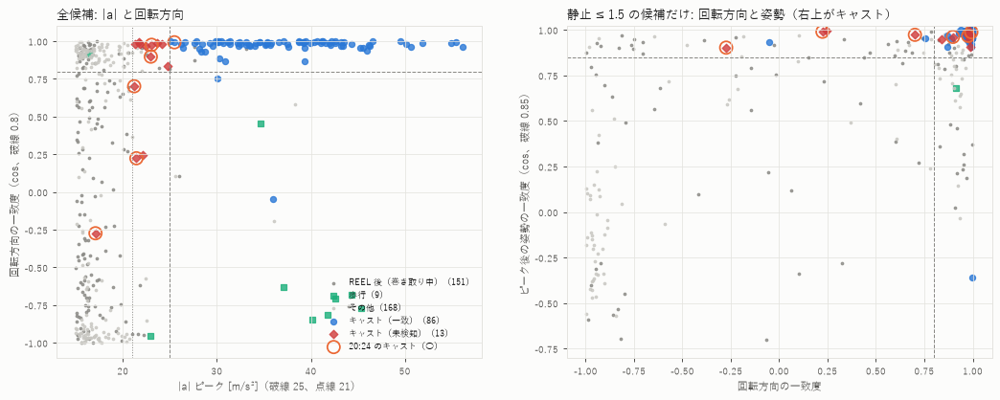

- **回転方向（ジャイロの向き）**【確認】: キャストは振りの強さによらず一致度がほぼ 1（未検知の弱いキャストも 13 件中 9 件が ≥ 0.8）。巻き取り中のピークは中央値 0.10、歩行は −0.71 で、**強さに依存しない区別ができる**。\|a\| の大きさではなく「どの向きに振ったか」を見る特徴
- **キャスト後の姿勢（重力の向き）**【確認】: キャスト直後にロッドを構えた手首の向きは毎回ほぼ同じ（一致度の中央値 0.98）。巻き取り中は 0.82、その他は 0.75 とばらつく。単独では弱いが、回転方向と組み合わせると残りの非キャストを落とせる
- **ピーク後の静止**（現行）: 歩行と巻き取りの約半分を落とす。今回の未検知キャストは全件満たしているので、弱いキャストを拾う妨げにはなっていない
- **振りかぶり**（ピーク前の \|g\|）: 未検知キャストでは中央値 5.3 と小さく、弱いキャストを拾う方向では使いにくい（前回レビューの単発衝撃対策としては候補のまま）
- **その他に考えられるもの（未評価）**: ピーク前後のジャイロ 3 軸波形全体とのテンプレート相関（向きだけでなく形も見る）、キャスト後に巻き取りの周期的な動きが始まるかの確認（確定が遅れる。フリーリグのように着底を待つ釣り方では遅れが大きい）
- 注意【確認】: 回転方向と姿勢は**装着腕・装着向きに依存する**。右腕に付けると符号が変わるので、装着腕の設定か軸の反転が必要（CLAUDE.md の将来方針と同じ）。また 20:24 のように振り方そのものが違うと、向きの条件で落ちる

### 11.5 弱いキャストを拾い、歩行・巻き取りの誤検知を増やさない方法

候補（\|a\| 閾値・\|g\| ≥ 4・静止 ≤ 1.5 を満たすもの）に回転方向・姿勢の条件を加え、そのあと現行と同じ近接抑制（5 秒）をかけた what-if。**検知器・アプリは変えていない**。

| 検知器 | 10/31 TP | 10/31 対応しない（うち FALSE 対象） | 20:24 TP | 21:19 移動 | 10/25 15:09 TP / 誤検出 ※ | 10/25 likely TP / 候補 | 10/25 11:34（実 2 回）検出数 | 10/25 uncertain 対応しない | 10/25 none 件/時 | 10/25 08:53 歩行 |
|---|---|---|---|---|---|---|---|---|---|---|
| P1（現行） | 86/99 | 6（2） | 1/6 | 0 | 28/30 / 0 | 14/15 / 0 | 5 | 4 | 28.3 | 0 |
| A: \|a\| ≥ 21, \|g\| ≥ 5.5 | **98/99** | 8（1） | **5/6** | 0 | 29/30 / 1 | 15/15 / 1 | **10** | **15** | **40.7** | **4** |
| B: \|a\| ≥ 21 + 回転方向 | 93/99 | 7（0） | 3/6 | 0 | 29/30 / 0 | 15/15 / 0 | 6 | 9 | 28.3 | 0 |
| **C: \|a\| ≥ 21 + 回転方向 + 姿勢** | **92/99** | **4（0）** | 3/6 | 0 | 29/30 / 0 | 15/15 / 0 | **4** | 5 | 28.3 | **0** |
| D: \|a\| ≥ 18 + 回転方向 + 姿勢 | 92/99 | 6（0） | 3/6 | 0 | 29/30 / 2 | 15/15 / 0 | 5 | 9 | 28.3 | 0 |
| E: \|a\| ≥ 25 + 回転方向 + 姿勢 | 83/99 | 3（0） | 1/6 | 0 | 27/30 / 0 | 14/15 / 0 | 2 | 1 | 26.5 | 0 |

※ 15:09 は回転方向・姿勢のテンプレートを作ったセッションなので、案 B〜E にとっては学習データ（楽観的）。

- **案 C が最もバランスがよい**【確認: 上表】
  - 10/31: 見逃し 13 → 7、対応しない検出 6 → 4、FALSE 申告の 2 件はどちらも落ちる
  - 10/25（未知データ）: likely 15/15・候補 0、11:34 の検出 5 → 4（実キャスト 2 件のほかに 250.7 秒・797.3 秒が残る。797 秒付近は前回レビューの単発衝撃）、歩行 0 件、ラベルなし 28.3 件/時（現行と同じ）、uncertain の対応しない検出 4 → 5
  - 代償: P1 が拾っていた 3 件（21:02 の 2.4 秒・341.8 秒、21:20 の 611.3 秒）を失う。21:02 341.8 秒はピーク後の姿勢が大きく違い、21:20 611.3 秒は回転の向きが違う（y 軸まわり）【確認: 特徴量】。20:24 は回転の向きが違う 3 投を拾えない
- 案 A（閾値だけ下げる）は 10/31 では最良に見えるが、10/25 では誤検知が最も多い。**今回のデータで最適化した結果と、未知データでの予測が最も食い違う案**
- 案 D（\|a\| 18 まで下げる）は 10/31 では C と同じ TP で、10/25 では誤検出が増える。下げすぎ
- 案 E（閾値は 25 のまま、向き・姿勢だけ足す）は誤検知が最も少ないが、見逃しが増える。誤検知を最優先する場合の選択肢

**未知の実釣データに対する性能予測（推定）**

| 項目 | 現行 P1 | 案 C | 根拠 |
|---|---|---|---|
| 通常のオーバーヘッドキャストの Recall | 0.9 前後 | **0.93〜0.96 前後** | 10/31（20:24 を除く）で 85/93 → 89/93、10/25 likely・15:09 でも +1 件ずつ。いずれも少数で、±5 ポイント程度の幅がある |
| 意図的に弱い・違う振り方のキャスト（20:24 型） | ほぼ拾えない | **半分程度** | 20:24 で 1/6 → 3/6。6 投しかなく、振り方次第で大きく変わる |
| 歩行・移動中の誤検知 | ほぼ 0 | ほぼ 0 | 21:19・08:53 とも 0 件 |
| 作業・単発衝撃の誤検知 | 1 時間に数件 | 同程度かやや少ない | 11:34 で 5 → 4 件、10/31 で 6 → 4 件 |

- 上の予測は 10/25・10/31 の 2 日分（同じ釣り人・左腕装着）にもとづく。**別の釣り人・右腕装着・別の釣り方には当てはまらない**
- 案 C の閾値（0.8 / 0.85）は 15:09 の 28 件だけで決めたもので、余裕の取り方は粗い。次の complete データで確かめる必要がある

### 11.6 改善案の優先順位（§9 を更新）

1. **【高】回転方向と構え姿勢を条件に加え、\|a\| 閾値を 21 程度まで下げる（案 C）**
   - Kotlin 側も、ピーク時の角速度ベクトルと、ピーク後 0.5〜3 秒の加速度平均（静止フィルタと同じ窓）を求めるだけで実装できる。確定遅延は変わらない
   - 採用前に、10/31 と 10/25 の両方を tune に回し、**次回の実釣（complete を 1 本以上、歩行・作業を含む）を eval にして確かめる**
   - 装着腕の設定（または軸反転）とセットで設計する
2. **【高】評価基盤**: 事後入力の照合規則、`sessions.toml` への 10/31 追加、磯子 2 セッションの別扱い（§9 の 2 のまま）。案 C の評価には回転方向・姿勢を castlab の検知器に足す必要があり、Python と Kotlin の一致テストも更新が必要
3. **【中】投げ方の違うキャスト（20:24 型）の扱いを決める**: 数えるなら、回転方向のテンプレートを複数持つ（通常 / 弱い送り込み）か、向きの条件を緩めて姿勢・静止を重く見る。20:24 型のデータを意図的に集めてから検討する
4. **【中】単発衝撃への対策**（§9 の 3）: 案 C で FALSE 申告の 2 件は落ちたが、件数が少なく効果は確定しない
5. **【低】閾値だけを下げる案（案 A）は採用しない**。未知データで誤検知が増えるため
6. **【低】UI**（§9 の 5 のまま）

### 11.7 次回のフィールドテストで追加したい記録（§10 への追加）

- **釣り方ごとにセッションを分ける**: 今回のように通常のキャストと弱いキャスト（フリーリグの近投など）が混ざる日は、釣り方を変えたところでセッションを切り、メモに「通常 / 弱め / アンダー / ピッチング」を書く。20:24 型を独立に評価できる
- **歩行・作業を含む complete セッション**: 10/31 は歩行が 1.5 分しかなく、閾値を下げた副作用が見えなかった。移動・ルアー交換・取り込みを含めて、全キャストに CAST を付けたセッションがあると、案 C の誤検知を確定できる
- **キャスト中止は CAST の直後に OTHER** などの運用（§10 の 3）。21:20 1814 秒のような「向きの崩れた振り」が中止なのかを確かめられる

---

## 12. 20:06 の FALSE 申告 2 件（フック外しの動作という申告）（2026-11-01 追記 2）

### 追加情報（ユーザー申告。記憶に基づく仮説で、確定情報ではない）

- 20:06 のセッションでは、ルアーのフックがバッグに刺さり、外そうとして腕や竿をいろいろ動かしていた。FALSE 申告された 2 件は、そのときの動作かもしれない

数値の全体は [followup_results.md](followup_results.md) の F6（`studies/field_review_20261031_followup.py` の `sec_hook`）。

### 12.1 2 件は時間的に近接しているか → **近接していない（130 秒離れている）が、同じ「釣り開始前」の区間にある【確認】**

| イベント | 時刻（セッション開始から） |
|---|---|
| AUTO_CAST #1 | 129.8 s |
| AUTO_CAST #2 | 260.1 s（#1 の 130.2 s 後） |
| FALSE #3（→ #2）/ FALSE #4（→ #1） | 327.1 s / 328.2 s |
| 最初の CAST | 351.2 s |

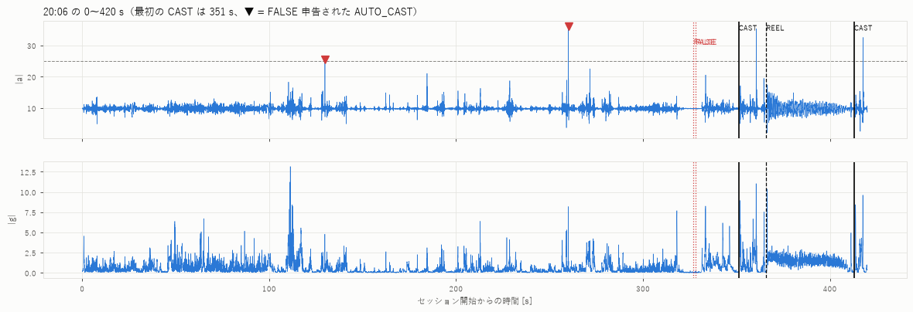

- 【確認】0〜330 秒は、\|g\| の平均が 0.2〜1.0 rad/s（釣り中の 30 秒平均は 1.2〜1.6）と小さく、その中に**数秒の小さな動きが断続的に出ては止まる**。110 秒付近には \|g\| 13 rad/s の短い激しい動きもある。釣り開始後（351 秒〜）の「キャスト → 巻き取りの周期的な動き」とは明らかに違う
- 【確認】FALSE を押す直前（約 315〜327 秒）はウォッチがほぼ静止している
- 【推定】断続的な小さな動きが約 5 分続く様子は、「フックを外そうとして腕や竿を動かしていた」という申告と矛盾しない。ただし、波形からは動作の中身（フック外し・仕掛けの準備・荷物の整理など）は区別できない。2 件が同じ 1 回の作業の中なのか、別々の作業なのかも分からない
- §0 で「2 回目の FALSE（#4 → AUTO #1）が意図したものか二度押しかは区別できない」としたが、申告どおりなら 2 件とも非キャストで、#4 も意図した申告だった可能性が高い【推定】

### 12.2 周辺の加速度・ジャイロ波形は通常のキャストとどう違うか

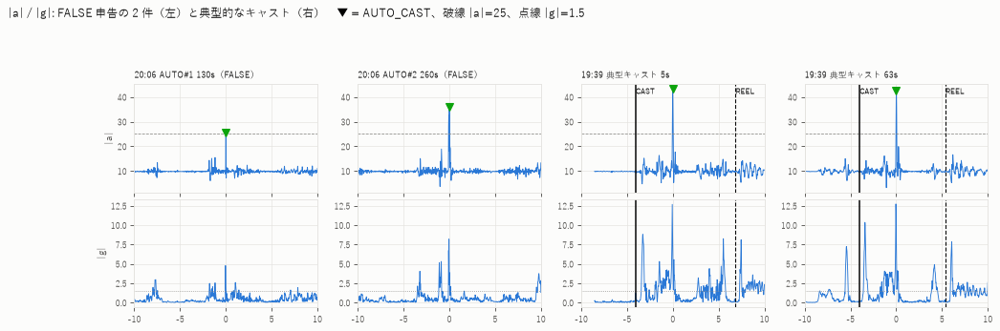

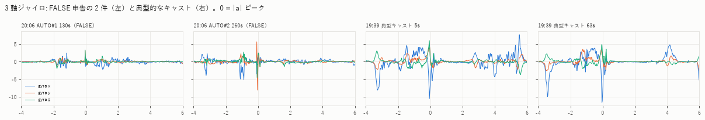

| 対象 | \|a\| | \|g\| ピーク | ピーク後静止 | 振りかぶり | 振りの回転量 [rad] | 回転方向 | 姿勢 | 角速度ベクトル（ピーク時） |
|---|---|---|---|---|---|---|---|---|
| AUTO #1 129.8 s | 25.5 | 4.8 | 0.72 | 2.5 | **0.55** | **0.10** | 0.97 | (+1.3, +3.2, +3.3) |
| AUTO #2 260.1 s | 36.0 | 8.2 | 0.45 | 5.2 | **1.92** | **−0.19** | 0.85 | (+1.1, −8.1, −0.6) |
| 一致キャスト 中央値 | 35.9 | 11.4 | 0.18 | 8.4 | 4.06 | 0.99 | 0.98 | 典型 (−10, +1, +5) |
| 一致キャスト 最小 | 25.0 | 6.4 | 0.07 | 1.9 | 2.10 | −0.05 | −0.36 | |

- 【確認】**通常のキャスト**: ピークの 1〜2 秒前から複数軸で大きく回り（振りかぶり → 振り下ろし）、振り下ろしの瞬間に x 軸まわり負・z 軸まわり正の鋭い山が出る。振りの回転量（ピーク −1.0〜+0.3 s の \|g\| 積分）は 2.1〜5.0 rad
- 【確認】**AUTO #1**: 振りかぶりが無く、0.1 秒ほどの鋭い \|a\| の突き上げだけ。\|g\| も 4.8 と小さく、向きもばらばら。回転量 0.55 rad はキャストの 1/4 以下。前後の波形から見ると「何かを引っ張った・ぶつけた」ような単発の衝撃に近い【推定】
- 【確認】**AUTO #2**: \|a\| 36 はキャストの中央値並みだが、ジャイロは **y 軸まわりだけの 0.1 秒の鋭い回転**（−8.1 rad/s）で、キャストの回転軸（x・z）と違う。回転量 1.92 rad も、キャストの最小（2.10）より小さい。手首を素早くひねった・引いたような動き【推定】
- 【確認】どちらもピーク後は静止している（静止の長さは #1 1.0 s・#2 9.6 s）。作業の合間に手を止めた瞬間と考えられ、キャスト後の静止と区別がつかない

### 12.3 誤検知と判定された原因（どの条件を通ったか）【確認】

| 条件（P1） | 閾値 | AUTO #1 | AUTO #2 | 通った理由 |
|---|---|---|---|---|
| \|a\| ピーク | ≥ 25 | 25.5（ぎりぎり） | 36.0 | 単発の衝撃でも \|a\| は大きくなる。大きさだけを見ていて、持続時間を見ていない |
| \|g\| 最大（ピーク −1.5〜+0.5 s） | ≥ 4 | 4.78（ぎりぎり） | 8.19 | 回転の大きさだけを見ていて、向きと量（積分）を見ていない |
| ピーク後静止（+0.5〜3 s の \|g\| 平均） | ≤ 1.5 | 0.72 | 0.45 | 断続的な作業では、動きの合間に手が止まる。キャスト直後の静止と同じに見える |
| 近接抑制 | 5 s | — | — | 130 秒離れており、影響なし |

- P1 は「強いピーク → 止まる」だけを見ているので、**振りかぶりの無い単発の動き → 手を止める**、という作業中のパターンを通してしまう
- 落とせた可能性のある特徴: 回転方向（#1 0.10・#2 −0.19、閾値 0.8）、振りの回転量（0.55・1.92、キャストの最小 2.10）、振りかぶり（#1 2.5。ただしキャストにも 1.9〜2.9 が 3 件あり単独では使えない）、\|g\| ピーク（#1 4.8。§9 の \|g\| ≥ 5.5 なら #1 だけ落ちる）

### 12.4 弱いキャストの検出率を上げた場合、このような非キャスト動作の誤検知は増えるか

最初の CAST の 2 秒前（約 349 秒）までの「釣り開始前の作業区間」で、検知器ごとの検出を数えた（§11 と同じ what-if。検知器は変えていない）。

| 検知器 | 釣り開始前の検出（時刻 s） | 件数 |
|---|---|---|
| \|a\| ≥ 25（現行 P1） | 129.8, 260.1 | 2 |
| \|a\| ≥ 23 / 21（\|g\| ≥ 4、静止 ≤ 1.5） | 129.8, 260.1 | 2 |
| \|a\| ≥ 20 | 129.8, 260.1, 333.5 | 3 |
| \|a\| ≥ 18 | 129.8, 228.7, 260.1, 333.5 | 4 |
| 案 A: \|a\| ≥ 21, \|g\| ≥ 5.5 | 260.1 | 1 |
| 案 B: \|a\| ≥ 21 + 回転方向 | なし | 0 |
| **案 C: \|a\| ≥ 21 + 回転方向 + 姿勢** | **なし** | **0** |
| 案 D: \|a\| ≥ 18 + 回転方向 + 姿勢 | なし | 0 |

- 【確認】\|a\| を 21 まで下げても、この区間の検出は増えない（\|a\| 21〜25 の候補は 184.5 s と 271.6 s の 2 件あるが、\|g\| がそれぞれ 3.1・3.97 で、現行の \|g\| ≥ 4 で落ちる。271.6 s はぎりぎり）。**20 以下に下げると作業中の動きを拾い始める**（333.5 s は最初の CAST の 18 秒前で、キャスト準備の動作と思われる【推定】）
- 【確認】回転方向を条件に加えた案 B〜D は、\|a\| を 18 まで下げてもこの区間で 0 件。FALSE 申告の 2 件も落ちる
- 【確認】ただし、この区間は 1 セッションの約 6 分しかない。10/25 の歩行・11:34 の作業を含めた評価は §11.5 のとおりで、閾値だけを下げる案（A）はそちらで誤検知が増えている
- 【注意】AUTO #2 のような **y 軸まわりの回転**は、20:24 の弱いキャスト（421 秒など）や 21:20 611 秒の実キャストにも見られる（§11.1・§11.5）。回転方向の条件はこの種の非キャストを落とす一方、同じ向きで振った実キャストも落とす。20:24 型のキャストを数えるために向きの条件を緩めると、#2 のような作業動作が再び通る可能性がある
- 【未検証の候補】「振りの回転量 ≥ 2 rad 程度」は、今回の 2 件を落とし、キャストを 1 件も落とさない（一致キャストの最小 2.10、未検知キャストの最小 2.28）。ただし**この 2 件を見てから気づいた特徴で、余裕も 0.2 rad しかない**ので、このデータでの成績は評価にならない。次回の complete データで、回転方向と並ぶ候補として確かめる

### 12.5 まとめと改善案への反映

- フック外しという申告は、波形（釣り開始前の断続的な小さな動き、振りかぶりの無い単発の突き上げ）と矛盾しないが、**確かめることはできない**。本レポートでは引き続き「FALSE 申告された誤検知」として扱い、原因は「作業中の単発動作（申告による仮説）」と記載する
- §11.6 の優先順位は変えない。案 C（回転方向＋姿勢）はこの種の作業動作にも有効だった。これに「振りの回転量」を加えるかどうかは、次回データで評価する候補とする
- **次回の記録への追加**: 仕掛けの準備・フック外し・ルアー交換など、キャスト以外の作業を始めるときと終えるときに OTHER を押す（または、作業中は記録を止めずにメモに時刻を残す）。作業中の動作を非キャストの確定データとして使えるようになる

---

## 13. その後: 案 C を P2 候補として実装（2026-11-01）

案 C を、P1 と並行して動く **P2 候補** としてウォッチと castlab に実装した。P1 のパラメータと正式なカウントは変えていない。

- パラメータ: `analysis/params/p2_candidate.json` = Kotlin の `DetectorParams.P2_CANDIDATE`（\|a\| ≥ 21、\|g\| ≥ 4、静止 ≤ 1.5、回転方向 ≥ 0.8、構え姿勢 ≥ 0.85、近接抑制 5 s）
  - テンプレートは §11 と同じ 15:09 の平均を小数 4 桁に丸めた固定値。丸めても §11 の案 C と検出時刻が全セッションで一致した
- ウォッチ: P2 候補の検知は `AUTO_CAST_P2` として events.csv に記録するだけ（カウンター・振動・FALSE / MISS / UNDO の対象にしない、画面にも出さない）。meta は `candidate_detector_*`
- 回帰確認【確認】: §11.5 の表に「P2 候補（params/p2_candidate.json）」の行を足して再実行し、案 C の行と全列が同じ値になった（[followup_results.md](followup_results.md) F5）。
  既存の行（P1・案 A〜E）は実装前と同じ。Kotlin 版と Python 版は、10/25・10/31 の全セッションで検知時刻・特徴量（Double）が完全に一致した（`CastDetectorParityTest`。範囲は §13.1）
- 10/25・10/31 は P2 候補を作るのに使ったデータなので、ここでの成績は評価ではなく「実装が意図どおりか」の確認。性能の評価は次回以降の実釣で行う

### 13.1 確認の範囲と定義（コミット前の追加確認）

**「一致」の範囲**【確認】

| 比較 | 比べたもの | 一致の意味 |
|---|---|---|
| Kotlin 版 ↔ Python 版（`CastDetectorParityTest`、10/25・10/31 の全セッション × P1 / baseline_v1 / P2 候補） | グリッド番号・ピーク時刻（ns, Long）と、特徴量 \|a\| ピーク・\|g\| ピーク・ピーク後 \|g\| 平均・回転方向・構え姿勢（Double） | 特徴量も **Double の値として完全一致**（Python は `repr` の最短表記で書き出し、Kotlin で読み戻して `Double.equals` で比較）。中間値（グリッド上の \|a\| など）は出力を通して間接的に一致を確かめている |
| ウォッチの AUTO_CAST ↔ PC 再検知（P1、events.csv のある全セッション 97 件） | グリッド番号と、events.csv の detail（小数 4 桁の文字列） | グリッド番号は完全一致、特徴量は**小数 4 桁で一致**（ウォッチ上の値は 4 桁でしか残っていない）。`recorded_ns` は実機の時刻なので比べていない |
| ウォッチの AUTO_CAST_P2 ↔ PC 再検知 | — | **未確認**（P2 候補を載せたアプリでまだ記録していない） |

**確定遅延の定義**【確認】

| 値 | 定義 | 基準 |
|---|---|---|
| `confirmationDelayS` = 8.0 s | (近接抑制で比べる最大の点数 249 + 静止窓の終わり 150 + 1) / 50 Hz | アルゴリズム上の目安（設計値） |
| 7.980〜7.9995 s（中央値 7.991 s） | 検知を返した入力サンプルの `timestamp_ns` − ピーク時刻。10/25・10/31 の全セッションを JVM で流して計測（P1 194 件・P2 候補 200 件。停止時の確定を除く） | センサー時刻。配信の遅れを含まない。`CastDetectorStreamingTest` は「8.0 + 0.05 s 以内」を確認している |
| 8.004〜8.081 s（中央値 8.054 s。今回の 8 セッションでは 8.01〜8.08 s） | events.csv の `delay_ms` = `recorded_ns`（記録時の `elapsedRealtimeNanos`）− ピーク時刻 | ウォッチの実時間。上の値に、センサーからアプリへの配信の遅れ（記録開始時の確認で 46〜66 ms）と処理時間が加わる |

- 2 つは矛盾しない。P2 候補の `recorded_ns` は P1 の記録の後に取るので、P1 より処理時間ぶん（推定 μs 程度）だけ遅くなりうる

**負荷の見積もりの計測条件**

- 対象: 21:20 のセッション（`start_elapsed_realtime_ns` から `stop_elapsed_realtime_ns` まで 3,973.45 s = 66.2 分）。サンプル数は CSV の ACCEL 行 200,243 + GYRO 行 200,242 = **400,485 行**（meta の `accel_events` / `gyro_events` と一致）
- 計測: PC（AMD Ryzen 7 5700X）上の JUnit（JBR / OpenJDK 25.0.3）。CSV は先にメモリに読み込み、検知器の `onSample` と `finish` だけの時間を `System.nanoTime` で測った（CSV の書き込み・イベント記録・ファイル I/O は含まない）。各構成を 3 回ずつ空回ししてから 5 回測り、最小値を採用。1 回の実行での計測
- 結果: P1 単独 14.0 ms（34 ns/行）、P2 候補単独 14.7 ms、P1 + P2 候補 26.2 ms（65 ns/行）
- **ウォッチ上の CPU 時間・バッテリー消費は実測していない**。「ウォッチは PC の 1/20〜1/50 程度の速さ」という仮定からの推定（P2 候補の追加で 1 時間あたり CPU 0.5〜1.5 秒程度）で、バッテリーへの影響は「小さいと見込まれる」以上のことは言えない

**P2 候補の失敗の隔離**【確認: JVM のテスト】

- コミット前の確認で、P2 候補の記録の失敗（IOException）が共通の `fail()` を通ってセッション全体を止めてしまう点と、P2 候補の計算・記録が P1 の記録・振動より先に行われていた点を見つけたので直した
  - P2 候補の実行と記録を `CandidateDetectorRunner` に分け、検知器の例外・記録の例外（IOException を含む）はここで捕まえて P2 候補だけを止める
  - P2 候補は P1 の検知・記録・振動が済んでから呼ぶ
- `CandidateDetectorRunnerTest`: P2 候補なし / あり / 検知器の例外 / 記録の IOException / 記録の RuntimeException のそれぞれで、P1 の AUTO_CAST（時刻・detail）とカウンターがすべて同じになることを確認した
- ただし、これは RecordingSession と同じ順序でイベントログを動かしたテストで、**RecordingSession 自体（Handler・ファイル・実機）は動かしていない**

**イベント ID の連番について**【確認】

- Kotlin（`SessionEventLog`・画面）、Python（`castlab.io` / `device` / `report`）、解析スクリプトを確認し、ID の連番を前提にした処理（ID の差・範囲・件数との対応）は無かった。参照はすべて ID の照合（`byId`・`ref_id`・`isin`）と大小比較（画面の「新しい自動検知か」）だけ
- テスト: P2 候補が間に入って ID が飛ぶ状況で、FALSE の対象は P1 の AUTO_CAST だけ（P2 候補の ID を指定すると拒否）、MISS の `last_auto_id` は P1、UNDO は手動イベントだけをさかのぼる（Kotlin `SessionEventLogTest`）。castlab の読み込み・集計・FALSE の対応付け・P1 / P2 のパラメータ復元も同様（Python `test_io.py`）
- 画面に出る AUTO_CAST の番号（「#12」など）は、従来から手動マーカーと共通の連番だったので、P2 候補で飛び方が増えるだけ

### 13.2 実機で確認していない項目（次回の実機テスト）

| # | 項目 | 確認方法 | 期待する結果 |
|---|---|---|---|
| 1 | インストール・起動 | debug APK を Pixel Watch 3 に入れて記録を開始 | 従来どおり記録が始まる。画面に P2 候補の表示は出ない |
| 2 | 記録開始・停止 | 短いセッション（数分、キャスト数回）を記録して停止 | events.csv に AUTO_CAST と AUTO_CAST_P2 が両方入る。meta に `candidate_detector=P2_CANDIDATE`・`candidate_auto_cast_count`・`candidate_detector_active_at_stop=true` |
| 3 | P1 のカウンター・振動 | 2 と同じ | カウンター・振動は AUTO_CAST の件数と一致し、AUTO_CAST_P2 では振動しない |
| 4 | FALSE / MISS / UNDO | 記録中に各ボタンを押す | FALSE の対象表示は P1 の AUTO_CAST の番号。UNDO の対象に AUTO_CAST_P2 が出ない |
| 5 | 停止時の確定 | キャスト直後（8 秒以内）に停止 | P1・P2 候補とも `final_flush=1` の行が出る（判定待ちがあれば） |
| 6 | 長時間計測 | 1 時間以上の記録 | 記録が途切れない（0.2 秒超の欠損が増えない）。`delay_ms` が P1・P2 候補とも 8.0〜8.1 s 程度に収まる |
| 7 | 画面オフ・画面復帰 | 記録中に画面を消し、数分後に復帰 | センサーのまとめ届きがあっても P1 / P2 候補の結果が変わらない（PC 再検知と一致）。復帰後のカウンターが正しい |
| 8 | 取り出し・解析 | `pull-sessions.ps1` → `python -m castlab evaluate` | `.events.csv` が取り出される。セッションページに P2 候補の行が出て、PC 再検知と「一致 N / ウォッチのみ 0 / PC のみ 0」 |
| 9 | Kotlin ↔ 実機の一致 | 8 のページ、または `device.compare_with_pc(..., candidate=True)` | AUTO_CAST・AUTO_CAST_P2 とも、ウォッチのみ・PC のみが 0（記録停止直前を除く） |
| 10 | 負荷 | 同じ条件の記録で、開始・停止時のバッテリー残量を比べる（可能なら P2 候補なしのビルドとも比べる） | 10/31 以前と比べて目立った増加がない。※精度の高い比較は難しく、目安にとどまる |
| 11 | P2 候補の例外時 | 実機では意図的に起こせない（JVM テストのみ） | 起きた場合は meta に `candidate_detector_error=...`、`candidate_detector_active_at_stop=false`。P1 は続く |
| 12 | 右腕装着 | 今回は対象外 | 方向条件のテンプレートは左腕前提。右腕の記録では P2 候補の結果を評価に使わない |
